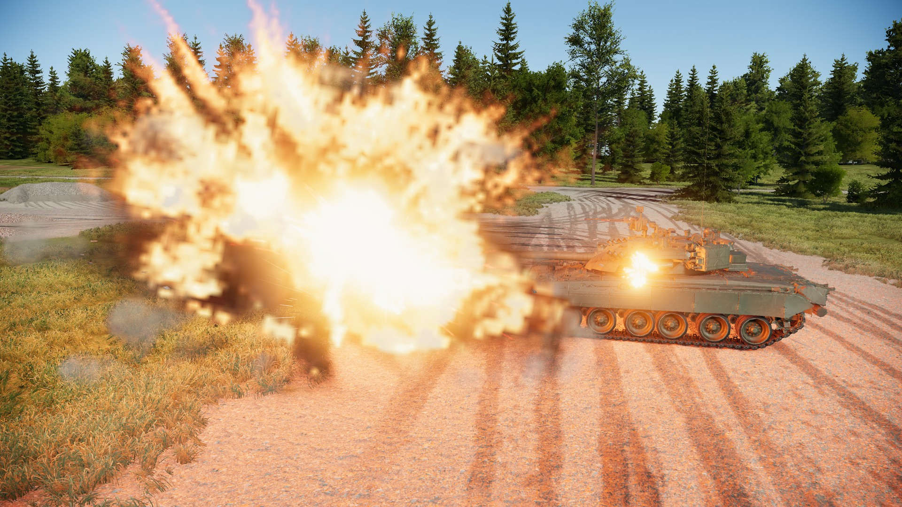
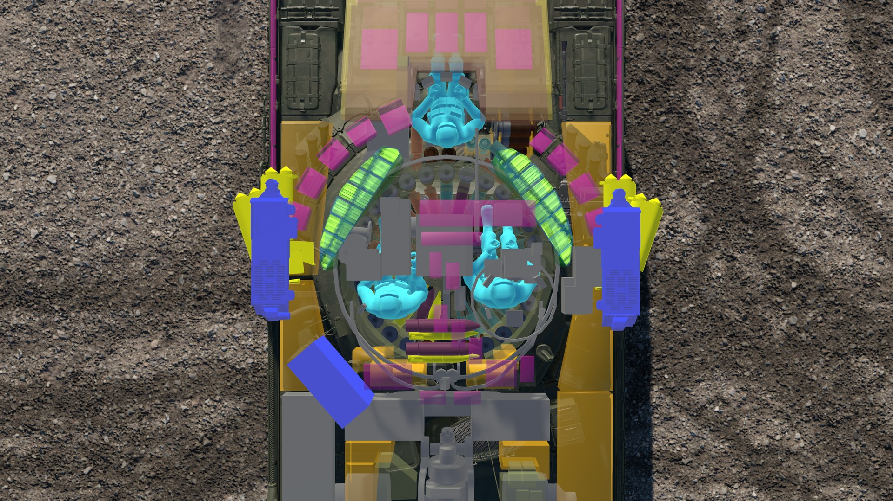
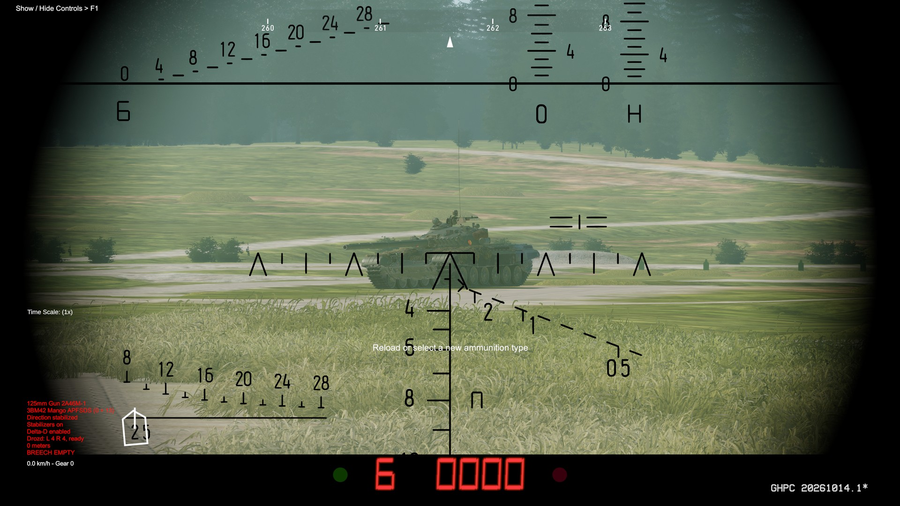
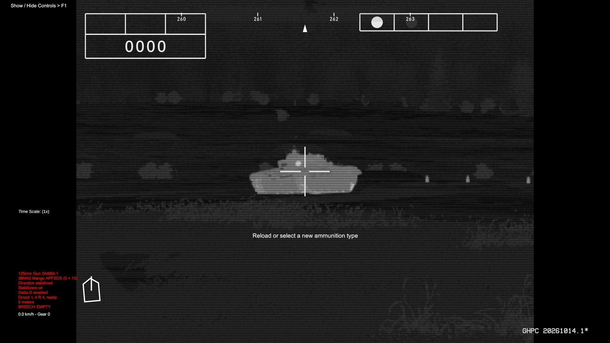
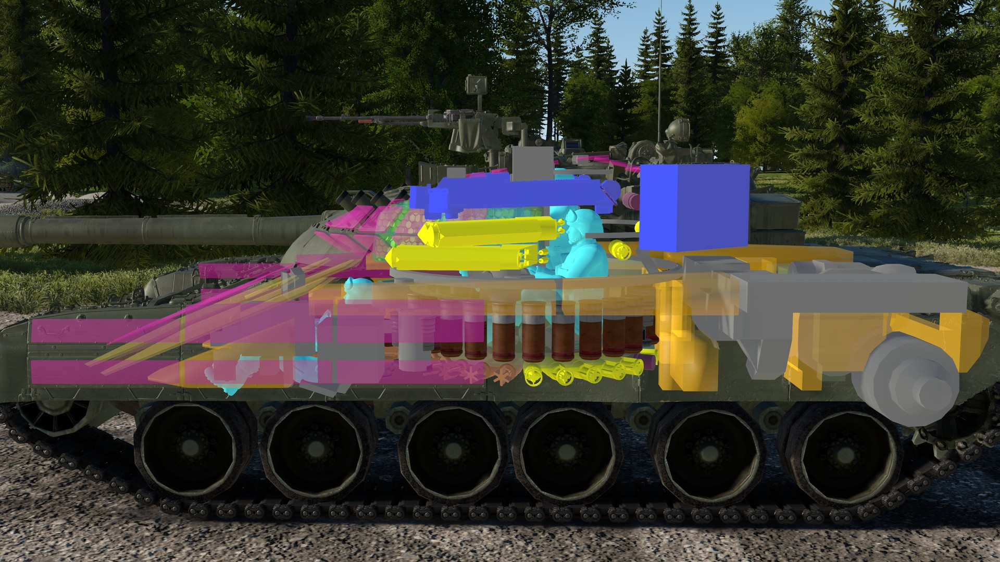

# T-80UM2 for Gunner, HEAT, PC!

A Russian **T-80UM2** you can drive and fight in GHPC, as its own unit. A T-80U with the **Drozd** («Дрозд») active
protection system on the turret front, Kontakt-5, the 1G46 sight, the TKN-4S with Dubl for the commander, the NSVT on its
pedestal, 3BM42 / 3BM59 / 3BM60 and the Invar missile, and the GTD-1250 gas turbine.

I made this mod for myself first, but you're welcome to use it too. It's still being worked on, so a few things can
change between versions. It's a separate mod from my [T-90A](https://github.com/marsattackk/GHPC-T90A),
[T-90M](https://github.com/marsattackk/GHPC-T90M) and [Leclerc SXXI](https://github.com/marsattackk/GHPC-LeclercSXXI),
and they all work fine installed together.

> [!IMPORTANT]
> Only one T-80UM2 was ever built, and almost nothing about it was published. A lot of this mod is the T-80U it was
> built from, plus my best guesses where even that runs out. I've been upfront about which is which, see
> [Overview](#overview) and [docs/details.md](docs/details.md#where-it-isnt-the-real-tank).

<p align="center">
  
  
</p>

*Left: the T-80UM2 with its Drozd blocks still on. Right: Drozd setting off an RPG grenade before it gets to the tank.*

No other mod needed, just MelonLoader.

## Installing it

1. Get [MelonLoader](https://github.com/LavaGang/MelonLoader/releases) (0.7.3 or newer) into GHPC if you don't have it already.
2. Download `T80UM2_<version>.zip` from [Releases](../../releases/latest).
3. Copy the `Mods` folder from the zip into the game's `Bin` folder, the one with `GHPC.exe`, `MelonLoader` and `Mods` in
   it (Steam: right-click GHPC > Manage > Browse local files opens the folder above it, so go into `Bin`). You should end
   up with:
   ```
   Mods\T80UM2.dll
   Mods\T80UM2\t80um2
   ```
4. Start the game. The T-80UM2 is in **Instant Action** (unit "T-80UM2"), in the **Soviet campaign** roster, and in the
   "Showcase of most playable vehicles" mission. In the campaign it's rare, since only one was built, and it turns up
   after 2 missions. You can turn that off or change it in the settings.

To remove it, delete `Mods\T80UM2.dll` and the `Mods\T80UM2` folder. That's safe mid-campaign too, the campaign save
doesn't keep a list of units, so nothing in it points at the T-80UM2.

Once per game start the mod asks GitHub whether there's a newer release. If there is, you get one line with a link in
the MelonLoader console and that's it: nothing in game, nothing downloaded. `Check for updates` turns it off.

## Overview

The T-80UM2 wasn't a production model. In the late 1990s the Omsk plant took a T-80U and bolted a Drozd system on the
turret front, four twin launcher blocks and a radar head on each side, the same kind of kit that had been on a few
T-55ADs since the early 80s. It was shown at the Omsk arms shows in 1997 and 1999 (the plant's own title for it was
basically "T-80U with the Drozd active protection system"), the name T-80UM2 comes later, from the press.

Nobody bought it, so it spent the 2000s as a trial tank at Kubinka. Later it ended up as an ordinary line tank in the
4th Guards Kantemirovskaya division with the launchers taken off, and it was destroyed near Trostyanets in March 2022.
So the tank in this mod is how it looked from 1997 to about 2012, with the Drozd blocks still fitted.

What's in it:

- **Drozd**, the hard-kill system: it shoots down missiles, RPG grenades and HEAT shells coming at the front.
- **Armour built for GHPC** for the T-80U's cast turret and glacis, with Kontakt-5 on top.
- **The T-80U's sights**: the 1G46 for the gunner, the TKN-4S for the commander, who can lay the gun himself (Dubl).
- **The NSVT** on its own pedestal on the commander's hatch, laid by hand through its K10-T sight.
- **40 rounds**, 28 in the carousel, and **weathered paint** made for its own shape.
- **The GTD-1250** gas turbine, 1250 hp, about 70 km/h on the road and 11 km/h in reverse.

In GHPC it's built on the game's T-80B, so the running gear, the hull, the carousel and the crew will all be familiar.
Above the turret ring it's a different tank. Against the T-80B it has much stronger cheeks, Kontakt-5, a proper modern
fire control with a thermal, longer rods and the Invar, and 150 hp more. The glacis without its ERA is about the same as
the T-80B's though, it's the Kontakt-5 that makes the difference there.

Against my [T-90A](https://github.com/marsattackk/GHPC-T90A) it's quicker, top speed and especially reverse (11 km/h
against the T-72's painful 4.2), and the cheeks are a bit stronger. Drozd and Shtora-1 do different jobs: Drozd actually
kills what's coming at you from the front, missiles, RPGs, HEAT shells, Shtora-1 confuses the guy aiming and covers you in
smoke, and neither does anything against APFSDS. What it loses: no remote MG (the NSVT's out in the open on the real
tank), a thinner glacis and 2 rounds fewer. From the side both are thin. My
[T-90M](https://github.com/marsattackk/GHPC-T90M) is a different league, to be fair it's a 2020s tank: Relikt, screens
all round, a thermal for both crew, a hunter-killer panorama and a much faster turret. What the T-80UM2 still has over it
is the speed, especially in reverse, a bit more cheek under the ERA, and Drozd. The full comparison with the T-80B and a
bit more history are in [docs/details.md](docs/details.md).

The looks come from War Thunder and so do the **shapes** of the armour plates, because War Thunder's damage model is a
pretty good map of where every plate and ERA box sits. What those plates are worth, and everything else that decides
what happens when a round hits, was built for GHPC with GHPC's own rules, and the armour has been shot at in game next
to a vanilla T-80B getting the same. The inside works like a vanilla tank: engine, transmission, the APU, drives, sights,
fire control, radio, the fuel tanks, the NSVT, the Drozd computer, each launcher block and each radar head are
damageable modules wired into the game's own systems, so knocking one out does what it does on a vanilla tank.

<p align="center">
  
  
</p>

*Left: the hit x-ray, the crew light blue, the modules grey, the Drozd blocks yellow and its radar heads blue. Right:
the turret front, two launcher blocks and a radar head each side, with their red covers.*

**How much of it is real.** Honestly, not as much as on my T-90s. There was exactly one of these and nobody published
its spec sheet. I know it existed, who built it, its history and what it looked like from photos dated 1997 to 2012, and
Drozd's layout (two twin blocks and a radar head each side, 8 rounds, the 80° sector, the 70-700 m/s window, 0.35 s per
side). Most of the rest I borrowed from the serial T-80U, on the bet that it was a T-80U under the Drozd: the armour, the
gun, the 1G46 / 1A45, the TKN-4S, the NSVT, the PKT, the smoke tubes, 70 km/h and the GTD-1250's 1250 hp. Drozd's timings
and kill chances come from the manual's specification and the state trials of 1981-82. And some of it is my guess, each listed in
[docs/details.md](docs/details.md#where-it-isnt-the-real-tank): the **Agava-2 thermal** (the T-80UM had one, but the photos of this tank show the older Buran-PA box, which is why
the Buran-PA is one setting away), the engine sub-type, the loader taking long rods (so 3BM59 and 3BM60 at all), Drozd's
finer details, the mass, the mantlet's armour and where several smaller parts go. Every one of them is listed in
[docs/details.md](docs/details.md#where-it-isnt-the-real-tank). If you've got a real source on any of that, I'd genuinely
love to see it.

**The paint.** Plain olive like the Kubinka photos, with the olive canvas mantlet cover. The weathering is made for the
T-80UM2's own shape: dust and mud heavier toward the ground, grime in the crevices, streaks, rust and chipped edges. Set
`Weathered paint` to false for a factory-fresh tank.

Mods that rework the game's T-80s by their name leave the T-80UM2 alone: it keeps its own name in game and
isn't converted by them.

AI T-80UM2s use Drozd, the sights and the ammo the same way you do. Only the NSVT is yours alone.

## Target alerts

The crew are the T-80B's, Russian voices and all, and they call targets on the hull azimuth compass. "At 30" is dead
ahead of the hull, 15 is straight left and 45 straight right. The official
[T-80B gunnery guide](https://gunnerheatpc.com/news/articles/gunnery-guide-t-80b) explains the system properly.

## 1A45 fire control with the 1G46 sight

<p align="center">
  
  
</p>

*Left: the gunner's 1G46. Right: the Agava-2 thermal.*

The gunner's day sight is the **1G46** (1Г46), with the **1A45 "Irtysh"** (1А45 «Иртыш») fire control behind it:
stabilised, a laser rangefinder from 400 to 5000 m, the reticle from the manual's figure with its stadia, and the range
and ammo readout under the picture. The stadia are set for a 2.5 m tall target. The readout strip shows the lased range,
the round and the ready lamp.

After a lase the gun won't fire until it has actually climbed to the elevation the computer set, which is what the real
firing-permission circuit does. With `Fire only when the gun is laid` off it fires whenever you like, but a shot while
the gun's still climbing falls short.

## Night fighting

The **Agava-2** («Агава-2») thermal is the default, on its monitor, 4° × 2.7° and 2° × 1.35° (width × height). The info blocks of the real
monitor (mode and range top left, the four boxes top right, the ready lamp) are from a photo. The thin centre cross is
mine, the photo doesn't show it clearly.

The photos of this tank show the older **TPN-4 Buran-PA** (ТПН-4 «Буран-ПА») image intensifier, so `Night sight` gives
you that instead, and you can swap in play. It's 5.25° wide with its own reticle (a best guess, I couldn't find a
drawing) and the fire control computer off, as on the real night channel.

## The commander's TKN-4S and the NSVT

<p align="center">
  
  
</p>

*Left: the commander's TKN-4S. Right: the NSVT's K10-T.*

The commander has the **TKN-4S "Agat-S"** (ТКН-4С «Агат-С»), day and night channels, 7.8° by day and 11.5° at night.
Two things on top of it:

- **Dubl** («Дубль»): the commander can lay and fire the main gun from the TKN-4S, range set by hand, no laser. That's
  the real tank's backup if the gunner's sight is knocked out. In Dubl the main gun's lines converge at 1600 m.
- **Target designation** (ЦУ): hold the game's Aim Override key in the commander's view and the turret slews onto what he's
  looking at.


*The NSVT on its pedestal next to the commander's hatch, the K10-T sight on top and a 100-round box on the side.*

A 12.7 mm **NSVT "Utyos"** (НСВТ «Утёс») on its own pedestal, 450 rounds (four boxes of 100 and one of 50), not
stabilised, laid by hand all round, -5° / +30°. Switch to the commander and select it like any other weapon, aim through
its **K10-T** (К10-Т) collimator sight, or straight from the commander's head view.

- The K10-T is drawn the way it looks through the real one: the reticle only inside the sight's glass, the world all
  round at 1x, the light filter in by day.
- On the real tank the commander has to stand up out of his hatch to use it. In the mod the hatch never opens: he fires
  it and changes the boxes from under armour, because the T-80B he's built on has no head-out position. So you're not
  exposed using it, which the real guy very much was.
- The belt feeds round by round from the box, the spent cases go out forward on the right onto the turret roof and lie there until it
  tilts or brakes hard enough to shake them off. `NSVT spent cases` turns them off.
- AI crews don't use it.

## Drozd

The «Дрозд» (Drozd) is on when the tank spawns and it works by itself. Each side has its own radar head and two twin
blocks, so 4 rounds a side, 8 in all, covering 40° either side of where the turret points in four 20° sectors. It
doesn't confuse the guy aiming the way the T-90A's Shtora-1 does, it shoots the thing down.

<p align="center">
  
</p>

- **What it shoots at**: anything coming in between 70 and 700 m/s, so ATGMs, RPG grenades, HEAT and HE shells.
  **Not APFSDS**, it's far too fast, same as the real one.
- **How**: the radar starts searching from about 330 m and tracks from about 130 m, the block fires a round that bursts 6-8 m in front of the tank and
  throws a cone of fragments into its path. The computer picks whichever tube's burst the missile will fly through, so
  shots at the glacis get caught too, but it's still two rounds per sector. Missiles go down every time (that's what
  the 1980s trials gave), grenades and shells most of the time.
- **What it can't see**: below -6° or above +20°, so a low shot from close in or a top attack gets through, and
  nothing on the sides or rear.
- **Each side** needs 0.35 s before it can fire again, so two missiles at once on the same side can still get through.
  The other side doesn't care, it's got its own radar.
- **It's not friendly to infantry.** The fragments go forward, and anyone standing in front of the tank when it fires
  is in trouble. Nobody behind is.

Using it:

- **Weapon info, bottom left**: a line like `Drozd: L 4 R 4, ready`, rounds left on each side and the state.
- **Vehicle menu > Drozd > Toggle APS** switches it off and on. Switched back on it takes **5 minutes** to warm up
  before it's ready, as the real one did.
- **Vehicle menu > Drozd > Reload** refills the empty tubes, 60 s a round, with the tank stopped.
- It won't fire while a crew hatch is open.
- A launcher block or radar head that gets hit is lost for the rest of the mission, and that side's sectors with it.
- The red covers on the tube mouths go with each shot and come back on reload.
- Intercepts and reloads get a line in the MelonLoader console.
- `Drozd` in the settings takes it off the tank (the blocks stay, they just do nothing).

The real tank also has eight 902B "Tucha" (902Б «Туча») smoke tubes with 3D17 grenades, the same as the T-80B's. Here
they're the game's ordinary smoke salvo. How each part of the Drozd works is in [docs/screens.md](docs/screens.md).

## Armour protection


The armour values are mine, not War Thunder's. Every plate got its thickness and strength from Russian sources on the
T-80U family, or, where nothing was published, the closest real equivalent, with each guess named in [docs/armour.md](docs/armour.md). From the front,
above the ring, it's strong. Straight from the front, in mm of steel, without ERA:

| | Turret cheeks (vs APFSDS / vs HEAT) | Upper glacis (vs APFSDS / vs HEAT) |
|---|---|---|
| **T-80UM2** | **744 / 984** | **485 / 653** |
| T-90A | 690 / 819 | 549 / 748 |
| T-90M | 690 / 820 | 552 / 752 |
| T-80B (vanilla) | 595 / 669 | 485 / 602 |

Kontakt-5 adds about 140 vs APFSDS and 550 vs HEAT on top. The T-80UM2 and both T-90s are measured in game on their cheek
block and glacis, the vanilla T-80B from its armour in the game's files over the whole cheek face, so its thin edges pull
its median down a bit.

The open-source figures for the T-80U's turret (620 / 900 on the cheeks, 430 / 566 on the glacis) would put it below
where GHPC's own tanks sit, because the game's vanilla T-80B and T-72M1 come out about 10-20 % above their own published
figures. So by default the T-80UM2 gets the same step up the T-90A got on the cheeks (744 / 984), and the glacis matches
the vanilla T-80B's against APFSDS (485 / 653), which keeps the three in the right order next to each other. Set
`Armour preset` to `"source-only"` for the plain published figures. Only the strength changes, not the layout, and
Kontakt-5 is the same in both.

The weak spots, from the armour values and my test firing:

- **The lower front plate** under the glacis is the usual T-80 weak spot, APFSDS and HEAT go through.
- **The mantlet** round the gun is cast steel without the cheeks' filling.
- **The glacis without its Kontakt-5** is no better than a T-80B's. Once a box has gone off, that spot's open.
- **The Drozd blocks** on the turret front corners are lightly armoured boxes. A hit takes that block out, and losing a
  radar head blinds that whole side.
- **From the side** it's 80 mm of hull, which stops nothing a tank fires, with the fender fuel tanks in the way. The
  turret sides are thinner than the cheeks too.
- **From above** the roof is 30 mm and the engine deck 20.

Where the numbers come from, my test firing and every weak spot: [docs/armour.md](docs/armour.md).

## Ammunition



*Pressing O: the carousel under the turret floor and the hand-stowed rounds round it.*

40 rounds, 28 in the carousel and 12 by hand round the fighting compartment. You pick the APFSDS (3BM42, 3BM59 or 3BM60)
in the game's normal ammo menu, 3BM42 is the default because it's what a serial T-80U carried. The autoloader runs at
7.1 s a round.

| Round | Penetration |
|---|---|
| 3BM42 "Mango" (default) | ~580 mm at the muzzle, ~460 mm at 2 km |
| 3BM59 "Svinets-1" | ~600 mm at the muzzle (a guess, see below) |
| 3BM60 "Svinets-2" | ~690 mm at the muzzle, ~600 mm at 2 km |
| 9M119M "Invar" | 700 mm, tandem warhead (sets off ERA first), guided along the gunner's sight line |
| 3BK18M HEAT, 3OF26 HE-Frag | the game's own rounds |

- **28 in the carousel** under the turret floor, like every T-80.
- **12 by hand**: in the T-80B's tank rack and its documented places, 4 shells across the turret rear and 2 charges
  on the hull's left.
- The real T-80U carries 45. The 5 extra places I had were right round the gunner's head, which looked daft and would
  have cooked him on the first hit, so I left them out. 40 is a choice, not a source.
- **3BM59 and 3BM60** are long rods the serial T-80U's loader can't take, later T-80s had it reworked for them. I've
  assumed this tank's was too, so treat those two as "what if".
- The coax PKT has 1250 rounds (5 belts of 250), the NSVT 450.

## Settings

After the first start, `UserData\MelonPreferences.cfg` in the game folder has a `[T-80UM2]` section (close the game
before editing it):

| Setting | Values | Default |
|---|---|---|
| `Enabled` | true / false: false leaves the T-80UM2 out of the game | true |
| `Add to campaign roster` | true / false | true |
| `Campaign prevalence` | how common it is (1 = as common as a typical tank) | 0.15 |
| `Campaign unlock after missions` | number | 2 |
| `Weathered paint` | true (dirt, wear and rust) / false (clean factory paint) | true |
| `APFSDS` | `"3BM42"` / `"3BM59"` / `"3BM60"` (where the game doesn't pick one itself) | 3BM42 |
| `Force APFSDS` | true: the campaign gives every T-80UM2 the `APFSDS` round instead of drawing one from its ammo supply | false |
| `Drozd` | true (the active protection is fitted) / false (the blocks are there but do nothing) | true |
| `Fire only when the gun is laid` | true (after a lase the gun won't fire until it has climbed to the elevation the computer set, like the real firing-permission circuit) / false (fires any time, like the game's own tanks, but a shot while it's still climbing after a lase falls short) | true |
| `ERA destruction effects` | true (a Kontakt-5 box that's gone off is gone with a blast, the plate round it sooted) / false (it looks as before, it still protects only once) | true |
| `NSVT spent cases` | true (the NSVT throws out its spent cases, they lie on the tank) / false (no cases, the belt still feeds) | true |
| `Night sight` | `"Agava-2"` (the thermal) / `"Buran-PA"` (the image intensifier the photos show), can be changed in play | Agava-2 |
| `Armour preset` | `"game-scale"` / `"source-only"` (the lower open-source figures) | game-scale |
| `Check for updates` | true: once per game start it asks GitHub whether a newer release is out and says so in the MelonLoader console, nothing is downloaded / false: no check | true |

There's also a `ConfigVersion` line at the end, the version that last wrote the section. Leave it alone, it's how the
mod tells which settings are still on an old default.

If your Windows uses a decimal comma and a settings editor saved a number as text (`"Campaign prevalence" = "0,3"`),
the mod reads it anyway, with a comma or a point, and says so in the log. MelonLoader on its own would quietly use the
default instead.

Most settings apply to T-80UM2s spawned after the change (`Night sight` changes at once). The three campaign settings take effect at the next mission
load, no restart needed.

## Bugs and suggestions

I'm open to suggestions, fixes, better sources, pull requests, whatever you've got. If you know something about the real
T-80UM2 (or the T-80U) that the mod gets wrong, tell me.

Found a bug? Open an [issue](../../issues) and attach `MelonLoader\Latest.log` from the game folder. The mod writes a
warning there whenever something didn't load right, a game update has renamed something it uses, or one of its hooks
into the game failed (the game carries on without it).

I only make and test the mod on the current Steam version of GHPC. A cracked copy or an old build might not load it at
all, and I can't help with those, so make sure you're on the latest Steam version before opening an issue.

I've made a few other mods for GHPC too, check out my [other repos](https://github.com/marsattackk?tab=repositories).

## Maintaining it

The whole source is here so anyone can keep the mod working after a GHPC update without waiting for me. Pull requests
are welcome, and under the GPL a fork is fine too.

`T80UM2\` is the tank itself and `Common\` is the machinery it's built with, shared with my other ports. `Resources\`
holds the data built into the DLL. The asset bundle (`Mods\T80UM2\t80um2`: model, textures, armour) isn't built from this
repo, and neither is the Unity project behind it, so take it from a release.

To build it you need the .NET SDK 6 or newer and GHPC with MelonLoader, because the build references the game's DLLs:

```
dotnet build -c Release -p:GameDir="<the game's Bin folder>"
```

`GameDir` is the game's `Bin` folder (defaults to the usual Steam location). The DLL lands in
`bin\Release\T80UM2.dll`.

When a game update breaks something, start with this:

```
powershell -ExecutionPolicy Bypass -File tools\check-game.ps1 -GameDir "<the game's Bin folder>"
```

It looks up every hook the mod has in the new game's DLLs without starting the game and lists what's gone. A broken
hook only takes its own feature down, and `MelonLoader\Latest.log` names it. [docs/game-updates.md](docs/game-updates.md)
goes through the rest of the repair and what to test after it.

`dotnet test tests` runs everything that doesn't need the game (the reticles, the armour data, the settings).
`tools\check-settings.ps1` makes sure the settings table above still matches the code, so a new setting needs a row there.

For the rest, [MAINTAINING.md](MAINTAINING.md) covers the layout, what happens when a T-80UM2 spawns, the settings and
releasing, and [docs/bundle.md](docs/bundle.md) says what the code expects to find in the bundle.

This README follows `main`, which can be ahead of the latest release.

## Where the model comes from, and the licence

The 3D model, its textures and the shapes of its armour plates are War Thunder's T-80UM2, taken from War Thunder's game
files. They belong to Gaijin Entertainment and they're not covered by this repository's licence. Everything else (the
armour values, Drozd, the sights and their reticles, the fire control, the ammo, the interior) was built for GHPC, from
Russian sources and, where those ran out, my own best guesses.

The source code in this repository is under the [GNU General Public License v3.0](LICENSE).
