# T-80UM2 for Gunner, HEAT, PC!

> [!NOTE]
> The T-80UM2 is still being worked on, so a few things can change between versions. If something looks or behaves
> wrong, tell me (see [Bugs and suggestions](#bugs-and-suggestions)).

> [!IMPORTANT]
> Only one T-80UM2 was ever built, and almost nothing about it was published. A lot of this mod is the T-80U it was
> built from, plus my best guesses where even that runs out. I've been upfront about which is which, see
> [How much of it is real](#how-much-of-it-is-real).

A Russian **T-80UM2** you can drive and fight in GHPC, as its own unit. A T-80U with the **Drozd** active protection
system on the turret front, Kontakt-5, the 1G46 sight, the TKN-4S with Dubl for the commander, the NSVT on its pedestal,
3BM42 / 3BM59 / 3BM60 and the Invar missile, and the GTD-1250 gas turbine.

I made this mod for myself first, but you're welcome to use it too.

It's a separate mod from my [T-90A](https://github.com/marsattackk/GHPC-T90A) and
[T-90M](https://github.com/marsattackk/GHPC-T90M), see [how they compare](#the-t-80b-the-t-80um2-the-t-90a-and-the-t-90m). You don't need either for it, and they all work fine installed
together.

<p align="center">
  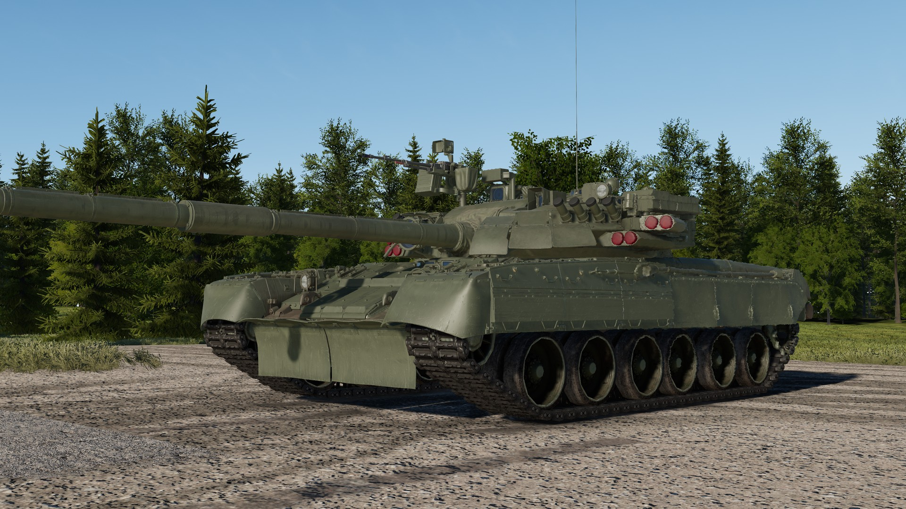
  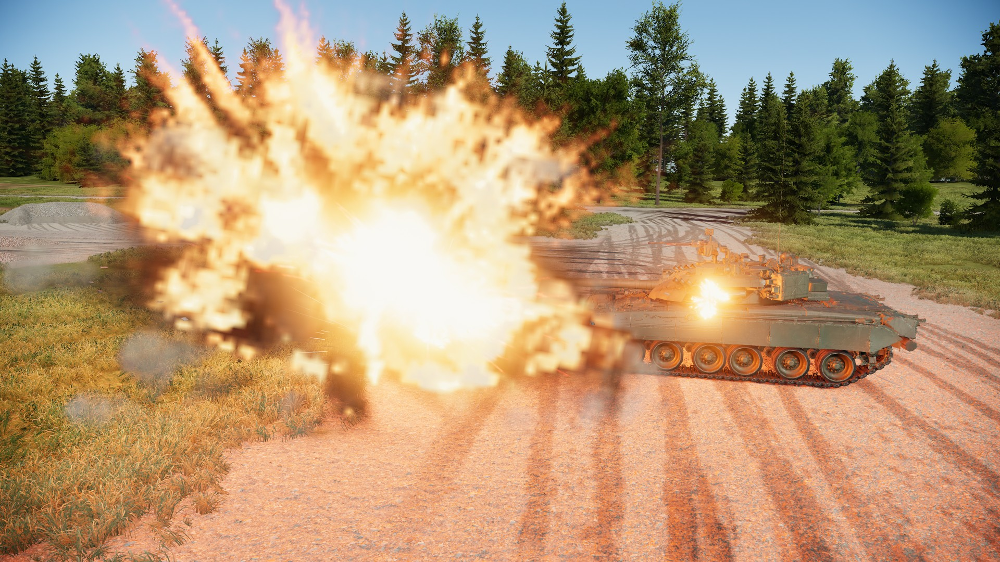
</p>

*Left: the T-80UM2 with its Drozd blocks still on. Right: Drozd setting off an RPG grenade before it gets to the tank.*

This README describes **version 0.1.0**. No other mod needed, just MelonLoader.

## Installing it

1. Get [MelonLoader](https://github.com/LavaGang/MelonLoader/releases) (0.7.3 or newer) into GHPC if you don't have it already.
2. Download `T80UM2_<version>.zip` from [Releases](../../releases/latest).
3. Copy the `Mods` folder from the zip into the game folder, the one with `GHPC.exe` in it (Steam: right-click GHPC >
   Manage > Browse local files). You should end up with:
   ```
   Mods\T80UM2.dll
   Mods\T80UM2\t80um2
   ```
4. Start the game. The T-80UM2 is in **Instant Action** (unit "T-80UM2"), in the **Soviet campaign** roster, and in the
   "Showcase of most playable vehicles" mission. In the campaign it's rare, a one-off tank should be, and it turns up
   after you've done 2 missions. You can turn that off or change it in the settings.

To remove it, delete `Mods\T80UM2.dll` and the `Mods\T80UM2` folder. That's safe mid-campaign too, the campaign save
doesn't keep a list of units, so nothing in it points at the T-80UM2.

## What's in it

- **Drozd**, the hard-kill system: it shoots down missiles, RPG grenades and HEAT shells coming at the front.
- **Armour built for GHPC** for the T-80U's cast turret and glacis, with Kontakt-5 on top.
- **The T-80U's sights**: the 1G46 for the gunner, the TKN-4S for the commander, who can lay the gun himself (Dubl).
- **The NSVT** on its own pedestal on the commander's hatch, laid by hand through its K10-T sight.
- **40 rounds**, 28 in the carousel, and **weathered paint** made for its own shape.
- **The GTD-1250** gas turbine, 1250 hp, about 70 km/h on the road and 11 km/h in reverse.

AI T-80UM2s use Drozd, the sights and the ammo the same way you do. Only the NSVT is yours alone.

## A bit of history

The T-80UM2 wasn't a production model. In the late 1990s the Omsk plant took a T-80U and bolted a Drozd system on the
turret front, four twin launcher blocks and a radar head on each side, the same kind of kit that had been on a few
T-55ADs since the early 80s. It was shown at the Omsk arms shows in 1997 and 1999 (the plant's own title for it was
basically "T-80U with the Drozd active protection system"), the name T-80UM2 comes later, from the press.

Nobody bought it, so it spent the 2000s as a trial tank at Kubinka. Later it ended up as an ordinary line tank in the
4th Guards Kantemirovskaya division with the launchers taken off, and it was destroyed near Trostyanets in March 2022.
So the tank in this mod is how it looked from 1997 to about 2012, with the Drozd blocks still fitted.

## The T-80B, the T-80UM2, the T-90A and the T-90M

The vanilla T-80B is what this mod is built on, the T-80U is basically the T-80B grown up, the T-90A (my other mod) is
the T-80U's rival from the T-72 side, and the T-90M (my other other mod) is where that line ended up 20 years later.
Here's how the four line up in game:

| | T-80B (vanilla) | **T-80UM2 (this mod)** | [T-90A](https://github.com/marsattackk/GHPC-T90A) (my mod) | [T-90M](https://github.com/marsattackk/GHPC-T90M) (my mod) |
|---|---|---|---|---|
| Turret cheeks, no ERA (vs APFSDS / HEAT) | 595 / 669 | **744 / 984** | 690 / 819 | 690 / 820 |
| Upper glacis, no ERA (vs APFSDS / HEAT) | 485 / 602 | **485 / 653** | 549 / 748 | 552 / 752 |
| ERA | none | **Kontakt-5**, about +140 / +550 | Kontakt-5, about +140 / +550 | Relikt, about +250 / +650, plus nets and slats |
| Protection system | none | **Drozd**: shoots incoming missiles, grenades and HEAT shells down, front ±40° | Shtora-1: IR jammer, laser warning, aerosol screens | TShU-1-2M: laser warning, aerosol screens |
| Gun | 2A46-2, -5° / +15° | **2A46M-1**, -5° / +14° (-4° over the engine deck) | 2A46M-5, -6° / +14° | 2A46M-5, -6° / +14° |
| Autoloader | 28 in the carousel, ~7.2 s | **28 in the carousel, 7.1 s** | 22 in the carousel, 6.5 s | 22 in the carousel, 6.5 s |
| Main gun ammo | 38 rounds | **40 rounds** | 42 rounds | 40 rounds, 10 of them in the bustle box |
| APFSDS | 3BM15, 3BM22 and co. | **3BM42**, 3BM59 or 3BM60 | 3BM42 or 3BM60 | 3BM60 or 3BM42 |
| Other rounds | 3BK18M HEAT, 3OF26 HE | **3BK18M HEAT, 3OF26 HE** | 3BK18M HEAT, 3OF26 HE | the same plus the 3OF82 Telnik air-burst |
| Missile | 9M112 Kobra | **9M119M Invar** (700 mm) | 9M119M Invar (700 mm) | 9M119M1 Invar-M (850 mm) |
| Gunner's sight | 1G42 with 1A33 fire control | **1G46 with 1A45**, laser 400-5000 m | 1G46 with 1A45T | Sosna-U, day and thermal in one head, Kalina fire control |
| Gunner's night sight | TPN-3-49 image intensifier | **Agava-2 thermal** (my guess, see below), or the TPN-4 Buran-PA | ESSA thermal, or the Buran-M | the Sosna-U's thermal channel |
| Commander | head view | **TKN-4S** day / night, Dubl (lays the gun), target designation | TKN-4S day / night | PK PAN panorama, TV and thermal, lays the gun, hunter-killer |
| Commander's MG | NSV on the cupola, for looks | **NSVT** on its pedestal, 450 rounds, hand-laid, K10-T sight | remote Kord, 300 rounds, fired from under armour | remote Kord MT on the panorama, 300 rounds |
| Coax | PKT, 2000 | **PKT, 1250** | PKT, 2000 | PKTM, 2000 |
| Smoke | 8 tubes | **8 × 902B**, 3D17 aerosol grenades | 12 × 902B, 3D17 aerosol grenades | 12 tubes, 3D17 aerosol grenades |
| Engine | GTD-1000TF gas turbine, 1100 hp | **GTD-1250 gas turbine, 1250 hp** | V-92S2 diesel, 1000 hp | V-92S2F diesel, 1130 hp |
| Top speed / reverse | ~60 / 13.6 km/h | **~70 / 11 km/h** | 60 / 4.2 km/h | 60 / 4.2 km/h |
| Turret traverse / gun elevation | 25 / 25°/s | **25 / 25°/s** | 24 / 28°/s | 40 / 28°/s |

So against the T-80B it's a different tank from the turret ring up: much stronger cheeks, Kontakt-5, a proper
modern fire control with a thermal, longer rods and the Invar, and 150 hp more. The glacis without its ERA is about the
same as the T-80B's though, it's the Kontakt-5 that makes the difference there.

Against the T-90A it's quicker, top speed and especially reverse (11 km/h against the T-72's painful 4.2), and the
cheeks are a bit stronger. Drozd and Shtora-1 do different jobs: Drozd actually kills what's
coming at you from the front, missiles, RPGs, HEAT shells, Shtora-1 confuses the guy aiming and covers you in smoke,
and neither does anything against APFSDS. What it loses: no remote MG (the NSVT's out in the open on the real tank),
a thinner glacis and 2 rounds fewer. From the side both are thin.

The T-90M is a different league, to be fair it's a 2020s tank. Its Relikt is a lot stronger than Kontakt-5, it has
screens all round, a thermal for both crew, a hunter-killer panorama, the Invar-M and a much faster turret. What the
T-80UM2 still has over it: the speed, especially in reverse, a bit more cheek under the ERA, and Drozd, which actually
kills an incoming missile instead of just warning you about the laser.

<details>
<summary><b>How the armour was measured</b></summary>

Median over a grid of straight-on shots. The T-80UM2 and both T-90s measured in game on their cheek block and glacis,
the vanilla T-80B from its armour in the game's files over the whole cheek face, so its thin edges pull its median down
a bit. The T-80B's top speed is what it actually reaches in game, its gearing would allow more but GHPC's track
resistance holds it at about 60.

</details>

## "It's a War Thunder model, does it even work in GHPC?"

Yes. The looks come from War Thunder, and so do the **shapes** of the armour plates, because War Thunder's damage model
is a pretty good map of where every plate and ERA box sits. What those plates are worth, and everything else that
decides what happens when a round hits, was built for GHPC with GHPC's own rules, and it's been shot at 504 times next to
a vanilla T-80B getting the same.

<details>
<summary><b>How it's built for GHPC</b></summary>

- **The armour values are mine, not War Thunder's.** Every plate got its thickness and strength from Russian sources
  on the T-80U family, or, where nothing was published, the closest real equivalent, marked as a guess in my notes.
- **It's built on the vanilla T-80B.** Running gear, hull internals, the carousel autoloader, the gas turbine's sound,
  the crew voices and the army all come from the game's T-80B, which is the right family. The T-80B's outer armour is
  swapped for the T-80UM2's.
- **The inside works like a vanilla tank.** Crew, ammo and the carousel sit where they are in a T-80U. Engine,
  transmission, the APU, drives, sights, fire control, radio, the fuel tanks, the NSVT, the Drozd computer, each launcher
  block and each radar head are damageable modules wired into the game's own systems, 26 of them, so knocking one out
  does what it does on a vanilla tank.
- **It's been shot at properly.** 504 rounds in game at 42 spots all over the tank, next to a vanilla T-80B getting the
  same, checking where every round stopped. Rounds got inside the T-80UM2 126 times out of 252, the T-80B 160 times.
- **It fits in.** The game's own glass, the vanilla paint finish, smoke tube caps that pop off on a salvo, the rubber
  flaps on the nose swinging as you drive, the exhaust hot in thermal, and a lighter model at range so it doesn't cost
  more to draw than it should.

</details>

<p align="center">
  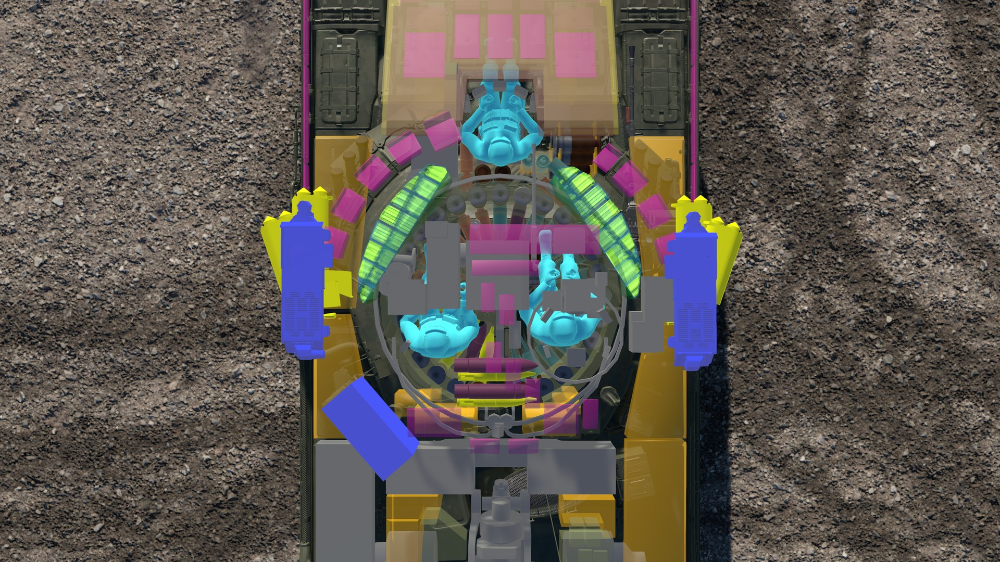
  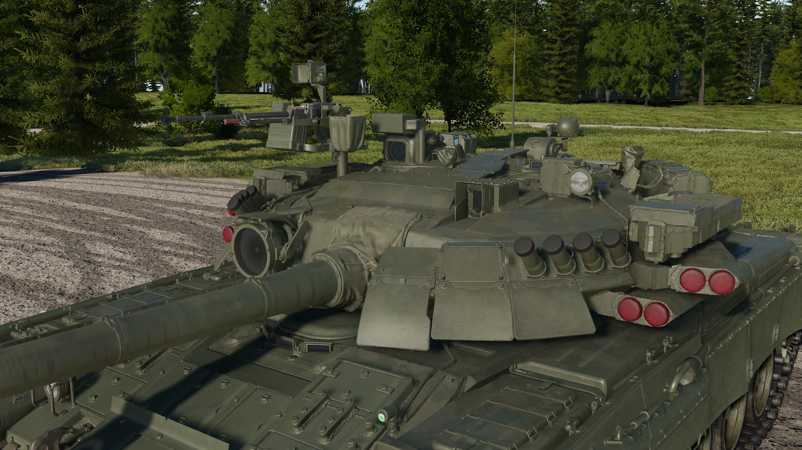
</p>

*Left: the hit x-ray, the crew light blue, the modules grey, the Drozd blocks yellow and its radar heads blue. Right:
the turret front, two launcher blocks and a radar head each side, with their red covers.*

## Drozd

It's on when the tank spawns and it works by itself. Each side has its own radar head and two twin blocks, so 4
rounds a side, 8 in all, covering 40° either side of where the turret points in four 20° sectors.

<p align="center">
  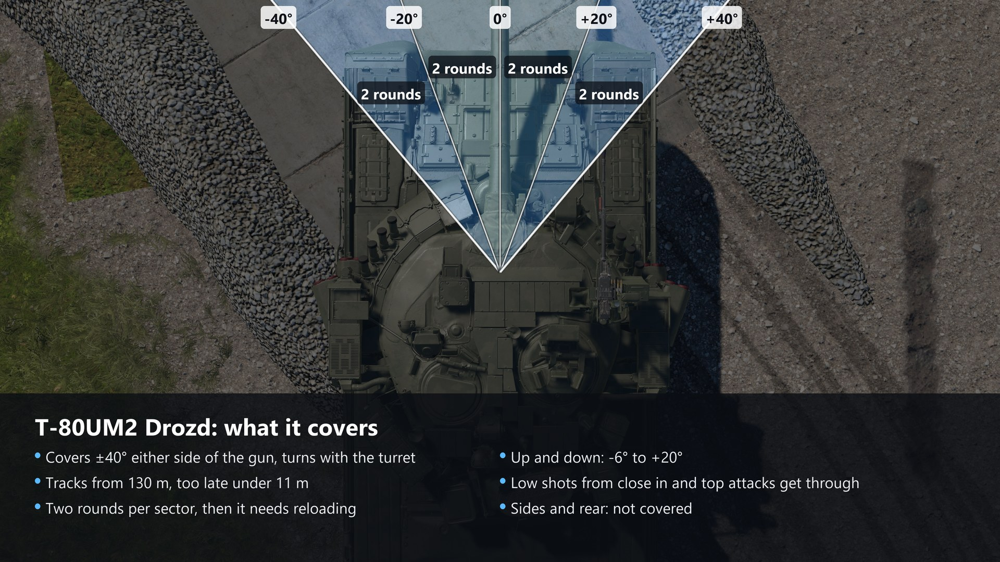
</p>

- **What it shoots at**: anything coming in between 70 and 700 m/s, so ATGMs, RPG grenades, HEAT and HE shells.
  **Not APFSDS**, it's far too fast, same as the real one.
- **How**: the radar picks it up about 130 m out, the block fires a round that bursts 6-8 m in front of the tank and
  throws a cone of fragments into its path. The computer picks whichever tube's burst the missile will fly through, so
  shots at the glacis get caught too, but it's still two rounds per sector. Missiles go down every time (that's what
  the 1980s trials gave), grenades and shells most of the time.
- **What it can't see**: below -6° or above +20°, so a low shot from close in or a top attack gets through, and
  nothing on the sides or rear.
- **Each side** needs 0.35 s before it can fire again, so two missiles at once on the same side can still get through.
  The other side doesn't care, it's got its own radar.
- **It's not friendly to infantry.** The fragments go forward, and anyone standing in front of the tank when it fires
  is in trouble. Nobody behind is.

<details>
<summary><b>Using it</b></summary>

- **Weapon info, bottom left**: a line like `Drozd: L 4 R 4, ready`, rounds left on each side and the state.
- **Vehicle menu > Drozd > Toggle APS** switches it off and on. Switched back on it takes **5 minutes** to warm up
  before it's ready, as the real one did.
- **Vehicle menu > Drozd > Reload** refills the empty tubes, 60 s a round, with the tank stopped.
- It won't fire while a crew hatch is open.
- A launcher block or radar head that gets hit is lost for the rest of the mission, and that side's sectors with it.
- The red covers on the tube mouths go with each shot and come back on reload.
- Intercepts and reloads get a line in the MelonLoader console.
- `Drozd` in the settings takes it off the tank (the blocks stay, they just do nothing).

</details>

## The sights

<p align="center">
  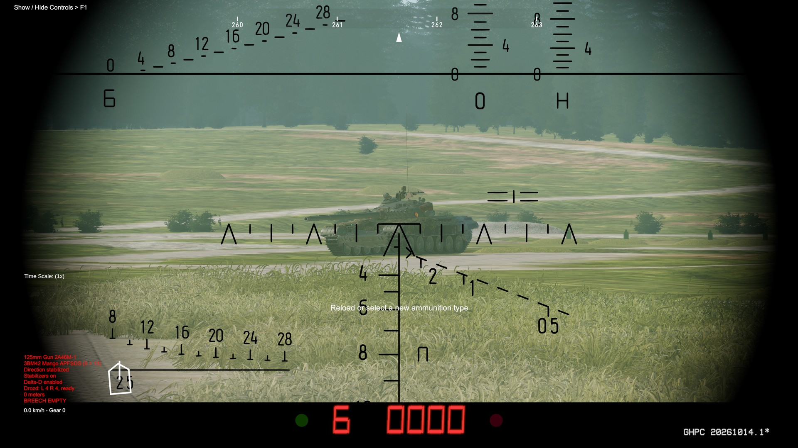
  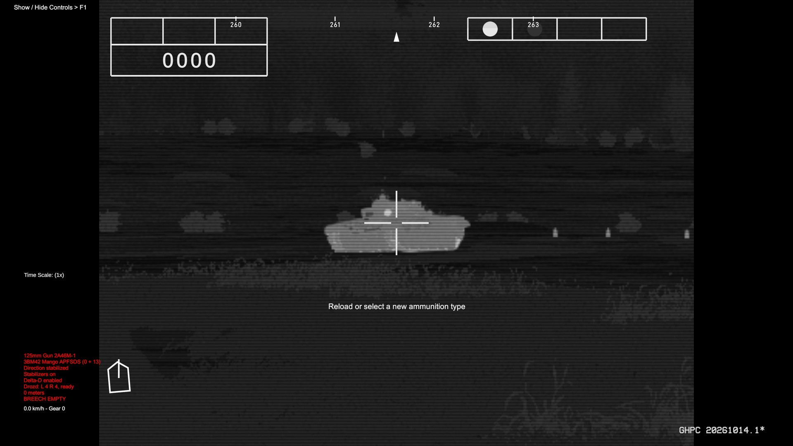
</p>
<p align="center">
  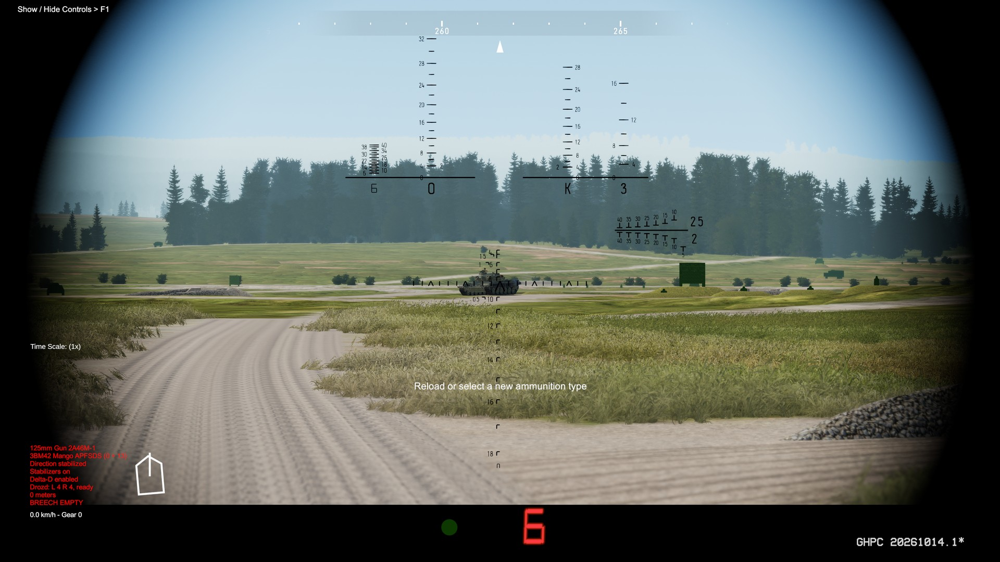
  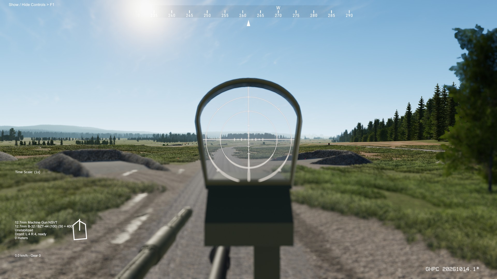
</p>

*Top: the gunner's 1G46 and the Agava-2 thermal. Bottom: the commander's TKN-4S and the NSVT's K10-T.*

- **1G46 + 1A45 "Irtysh"** for the gunner: stabilised, laser rangefinder 400-5000 m, the reticle from the manual's
  figure with its stadia, range and ammo readout under the picture.
- **Agava-2** thermal on its monitor by default, or the **TPN-4 Buran-PA** image intensifier as a setting (and you can
  swap in play).
- **TKN-4S "Agat-S"** for the commander, day and night channels.
- **Dubl**: the commander can lay and fire the main gun from the TKN-4S, range set by hand, no laser. That's the
  real tank's backup if the gunner's sight is knocked out.
- **Target designation**: hold the game's Aim Override key in the commander's view and the turret slews onto what he's
  looking at.

<details>
<summary><b>Sight details</b></summary>

- **1G46:** the reticle's stadia are set for a 2.5 m tall target. The readout strip shows the lased range, the round and
  the ready lamp.
- **Agava-2:** 2.7° and 1.35° wide, the info blocks of the real monitor (mode and range top left, the four boxes top
  right, the ready lamp) from a photo. The thin centre cross is mine, the photo doesn't show it clearly.
- **Buran-PA:** 5.25° wide, its own reticle (a best guess, I couldn't find a drawing), the fire control computer off,
  as on the real night channel.
- **TKN-4S:** 7.8° by day, 11.5° at night. In Dubl the main gun's lines converge at 1600 m.

</details>

## The NSVT

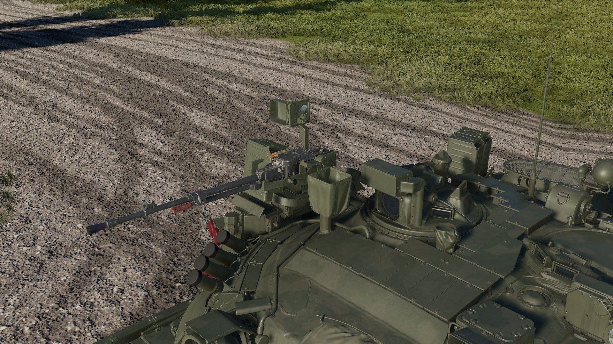

*The NSVT on its pedestal next to the commander's hatch, the K10-T sight on top and a 100-round box on the side.*

A 12.7 mm NSVT "Utyos" on its own pedestal, 450 rounds (four boxes of 100 and one of 50), not stabilised, laid by hand
all round, -5° / +30°. Switch to the commander and select it like any other weapon, aim through its K10-T collimator
sight, or straight from the commander's head view.

<details>
<summary><b>NSVT details</b></summary>

- The K10-T is drawn the way it looks through the real one: the reticle only inside the sight's glass, the world all
  round at 1x, the light filter in by day.
- On the real tank the commander has to stand up out of his hatch to use it. In the mod he fires it and changes the boxes
  with the hatch shut, because the T-80B he's built on has no head-out position. So you're not exposed using it, which the real guy very much was.
- The belt feeds round by round from the box, the spent cases go out forward on the right and lie on the tank until it
  tilts or brakes hard enough to shake them off. `NSVT spent cases` turns them off.
- AI crews don't use it.

</details>

## The ammo

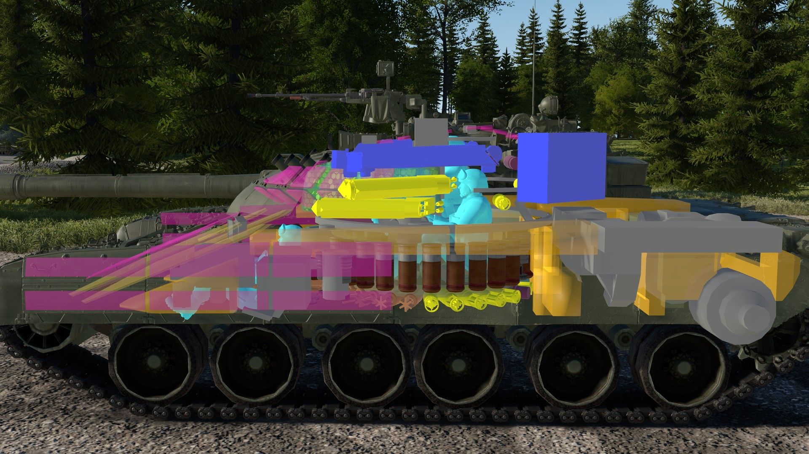

*Pressing O: the carousel under the turret floor and the hand-stowed rounds round it.*

40 rounds, 28 in the carousel and 12 by hand round the fighting compartment. You pick the APFSDS (3BM42, 3BM59 or 3BM60)
in the game's normal ammo menu, 3BM42 is the default because it's what a serial T-80U carried.

<details>
<summary><b>Where they go, and why 40</b></summary>

- **28 in the carousel** under the turret floor, like every T-80.
- **12 by hand**: in the T-80B's tank rack and its documented places, 4 shells across the turret rear and 2 charges
  on the hull's left.
- The real T-80U carries 45. The 5 extra places I had were right round the gunner's head, which looked daft and would
  have cooked him on the first hit, so I left them out. 40 is a choice, not a source.
- **3BM59 and 3BM60** are long rods the serial T-80U's loader can't take, later T-80s had it reworked for them. I've
  assumed this tank's was too, so treat those two as "what if".

</details>

## The paint

Plain olive like the Kubinka photos, with the olive canvas mantlet cover. The weathering is made for the T-80UM2's own
shape: dust and mud heavier toward the ground, grime in the crevices, streaks, rust and chipped edges. Set
`Weathered paint` to false for a factory-fresh tank.

## How much of it is real

Honestly, not as much as on my T-90s. There was exactly one of these and nobody published its spec sheet. Here's what
I actually had:

**About this tank itself** (photos, the maker's 1997 show entry, press reports):
- That it existed, who built it, its history, and what it looked like, from photos dated 1997 to 2012.
- Drozd's layout (two twin blocks and a radar head each side), 8 rounds, the 80° sector, the 70-700 m/s window, the
  0.35 s per side and that missiles were its main target.

**Borrowed from the serial T-80U**, on the reasonable bet that it was a T-80U under the Drozd (Russian sources on the
T-80U, btvt.info, manuals and the like):
- The armour (cheeks, glacis, Kontakt-5, hull plates), the gun and its limits, the 1G46 / 1A45, the TKN-4S, the NSVT and
  its 450 rounds, the PKT, the smoke tubes, the 45 rounds, 70 km/h and the GTD-1250's 1250 hp.
- Drozd's timings and kill chances, from the T-55AD's Drozd and its 1980s trials.

**My guesses**, each marked as a guess in my notes:
- **The Agava-2 thermal.** The T-80UM had one, but the photos of this tank show the older Buran-PA box. That's why the
  Buran-PA is one setting away.
- **The engine sub-type.** No source names this tank's engine, the GTD-1250 is what T-80Us had from 1990.
- **The loader taking long rods**, so 3BM59 and 3BM60 at all. 3BM59's penetration is a guess too, worked out from the
  3BM60's.
- **Drozd's details**: its 0.02 s reaction (worked back from an 11 m trial shot), which block takes which sector, how far
  its fragments do damage (5 m ahead of the burst), how often a kill only breaks the threat up instead of setting it off (1 in 4), and its 25 mm housings.
- **The mass** (the T-80U's 46 t plus the Drozd kit), the mantlet's armour, the anti-radiation lining (the T-64A's),
  where the APU and the fender tanks go, where the 12 hand-stowed rounds sit, the NSVT's speeds and box change time,
  the Buran-PA's reticle, the TKN-4S night field of view and the Dubl convergence range.
- **The armour strength**, see below.

If you've got a real source on any of that, I'd genuinely love to see it.

## Bugs and suggestions

I'm open to suggestions, fixes, better sources, pull requests, whatever you've got. If you know something about the real
T-80UM2 (or the T-80U) that the mod gets wrong, tell me.

Found a bug? Open an [issue](../../issues) and attach `MelonLoader\Latest.log` from the game folder. The mod writes a
warning there whenever something didn't load right, a game update has renamed something it uses, or one of its hooks
into the game failed (the game carries on without it).

I only make and test the mod on the current Steam version of GHPC. A cracked copy or an old build might not load it at
all, and I can't help with those, so make sure you're on the latest Steam version before opening an issue.

## More GHPC mods

I've made a few other mods for GHPC too, check out my [other repos](https://github.com/marsattackk?tab=repositories).

---

## More details

Click to open.

<details>
<summary><b>Settings</b></summary>

After the first start, `UserData\MelonPreferences.cfg` in the game folder has a `[T-80UM2]` section (close the game
before editing it):

| Setting | Values | Default |
|---|---|---|
| `Enabled` | true / false | true |
| `Add to campaign roster` | true / false | true |
| `Campaign prevalence` | how common it is (1 = as common as a typical tank) | 0.15 |
| `Campaign unlock after missions` | number | 2 |
| `Weathered paint` | true (dirt, wear and rust) / false (clean factory paint) | true |
| `APFSDS` | `"3BM42"` / `"3BM59"` / `"3BM60"` (where the game doesn't pick one itself) | 3BM42 |
| `Drozd` | true (the active protection is fitted) / false (the blocks are there but do nothing) | true |
| `Fire only when the gun is laid` | true (after a lase the gun won't fire until it has climbed to the elevation the computer set, like the real firing-permission circuit) / false (fires any time, like the game's own tanks, but a shot while it's still climbing after a lase falls short) | true |
| `ERA destruction effects` | true (a Kontakt-5 box that's gone off is gone with a blast, the plate round it sooted) / false (it looks as before, it still protects only once) | true |
| `NSVT spent cases` | true (the NSVT throws out its spent cases, they lie on the tank) / false (no cases, the belt still feeds) | true |
| `Night sight` | `"Agava-2"` (the thermal) / `"Buran-PA"` (the image intensifier the photos show), can be changed in play | Agava-2 |
| `Armour preset` | `"game-scale"` / `"source-only"` | game-scale |

There's also a `ConfigVersion` line at the end, the version that last wrote the section. Leave it alone, it's how the
mod tells which settings are still on an old default.

If your Windows uses a decimal comma and a settings editor saved a number as text (`"Campaign prevalence" = "0,3"`),
the mod reads it anyway, with a comma or a point, and says so in the log. MelonLoader on its own would quietly use the
default instead.

Most settings apply to T-80UM2s spawned after the change. The three campaign settings take effect at the next mission
load, no restart needed.

In the vehicle menu: Drozd's on / off switch and its reload.

</details>

<details>
<summary><b>The armour presets</b></summary>

The open-source figures for the T-80U's turret (620 / 900 on the cheeks, 430 / 566 on the glacis) would put it below
where GHPC's own tanks sit, because the game's vanilla T-80B and T-72M1 come out about 10-20 % above their own published
figures. So by default the T-80UM2 gets the same step up the T-90A got on the cheeks (744 / 984), and the glacis matches the
vanilla T-80B's against APFSDS (485 / 653), which keeps the three in the right order next to each other. Set `Armour preset` to `"source-only"` for the plain published figures.
Only the strength changes, not the layout, and Kontakt-5 is the same in both.

</details>

<details>
<summary><b>Weak spots</b></summary>

From the armour values and my test firing:

- **The lower front plate** under the glacis is the usual T-80 weak spot, APFSDS and HEAT go through.
- **The mantlet** round the gun is cast steel without the cheeks' filling.
- **The glacis without its Kontakt-5** is no better than a T-80B's. Once a box has gone off, that spot's open.
- **The Drozd blocks** on the turret front corners are lightly armoured boxes. A hit takes that block out, and losing a
  radar head blinds that whole side.
- **From the side** it's 80 mm of hull, which stops nothing a tank fires, with the fender fuel tanks in the way. The
  turret sides are thinner than the cheeks too.
- **From above** the roof is 30 mm and the engine deck 20.

</details>

<details>
<summary><b>Mobility, gun and ammo</b></summary>

| | |
|---|---|
| Engine | GTD-1250 gas turbine, 1250 hp, the T-80B's 4+1 gearbox with the T-80U's final drive |
| Mass | 47 t |
| Speed | about 70 km/h forward, 11 km/h reverse |
| Turret traverse / gun elevation | 25°/s / 25°/s |
| Gun | 2A46M-1, -5° / +14° over the front, -4° over the engine deck |
| Autoloader | 7.1 s, 28 rounds in the carousel |
| Main gun ammo | 40 rounds (28 carousel, 12 by hand): 3BM42, 3BM59 or 3BM60, 3BK18M HEAT, 3OF26 HE-Frag, 9M119M Invar |
| Coax PKT | 1250 rounds (5 belts of 250) |
| NSVT | 450 rounds (4 boxes of 100 and one of 50) |
| Smoke | 8 × 902B "Tucha", 3D17 aerosol grenades |
| Drozd | 8 rounds (4 a side), ±40°, 70-700 m/s |

| Round | Penetration |
|---|---|
| 3BM42 "Mango" (default) | ~580 mm at the muzzle, ~460 mm at 2 km |
| 3BM59 "Svinets-1" | ~600 mm at the muzzle (a guess, see above) |
| 3BM60 "Svinets-2" | ~690 mm at the muzzle, ~600 mm at 2 km |
| 9M119M "Invar" | 700 mm, tandem warhead (sets off ERA first), guided along the gunner's sight line |
| 3BK18M HEAT, 3OF26 HE-Frag | the game's own rounds |

</details>

<details>
<summary><b>What's not exactly like the real tank, and why</b></summary>

| What | In the mod | Why |
|---|---|---|
| Base vehicle | Built on the game's T-80B (running gear, hull internals, autoloader, turbine sound, voices) | The T-80U is a T-80B development, so it's the right family. |
| Armour strength | "game-scale" by default | Keeps it in the right place next to GHPC's own tanks. "source-only" is one setting away. |
| NSVT | fired with the hatch shut | The T-80B has no head-out position for the commander. On the real tank he's stood up in the open. |
| Drozd reload | 60 s a round, tank stopped | The maker gives 15 minutes for all 8. Close enough, and you can't do it on the move. |
| Drozd spares | as many as you need | Nothing says how many the tank carried. |
| Main gun ammo | 40 instead of 45 | The 5 missing places were round the gunner's head. |
| Smoke | 8 grenades, no spares | GHPC has no smoke restock, so the 4 spares the real tank carries wouldn't do anything. |
| Fuel | the T-80B's | Its tankage in game is near enough the T-80U's. |
| Top speed | tuned to reach ~70 km/h | On the sources' 1250 hp alone GHPC's track resistance held it at 63. |
| Autoloader | 7.1 s for every round | GHPC has one reload time per gun. |

</details>

<details>
<summary><b>Other mods</b></summary>

Mods that rework the game's T-80s by their name, PIL for one, leave the T-80UM2 alone: it keeps its own name in game
and isn't converted by them.

</details>

<details>
<summary><b>Building from source</b></summary>

This repository holds the mod's C# source (.NET Framework 4.7.2). You need the .NET SDK (6 or newer) and GHPC with
MelonLoader installed (the build references the game's assemblies):

```
dotnet build -c Release -p:GameDir="<GHPC folder>\Bin"
```

`GameDir` is the folder with `GHPC.exe` in it (defaults to the usual Steam location). The DLL ends up in
`bin\Release\T80UM2.dll`. The asset bundle (`Mods\T80UM2\t80um2`: model, textures, armour) isn't built from this source,
take it from the release zip.

Layout: `T80UM2\` the mod, `Common\` the helpers it's built with, `Resources\` data embedded in the DLL.

</details>

## Where the model comes from, and the license

The 3D model, its textures and the shapes of its armour plates are War Thunder's T-80UM2, taken from War Thunder's game
files. They belong to Gaijin Entertainment and they're not covered by this repository's license. Everything else (the
armour values, Drozd, the sights and their reticles, the fire control, the ammo, the interior) was built for GHPC, from
Russian sources and, where those ran out, my own best guesses.

The source code in this repository is under the [GNU General Public License v3.0](LICENSE).
