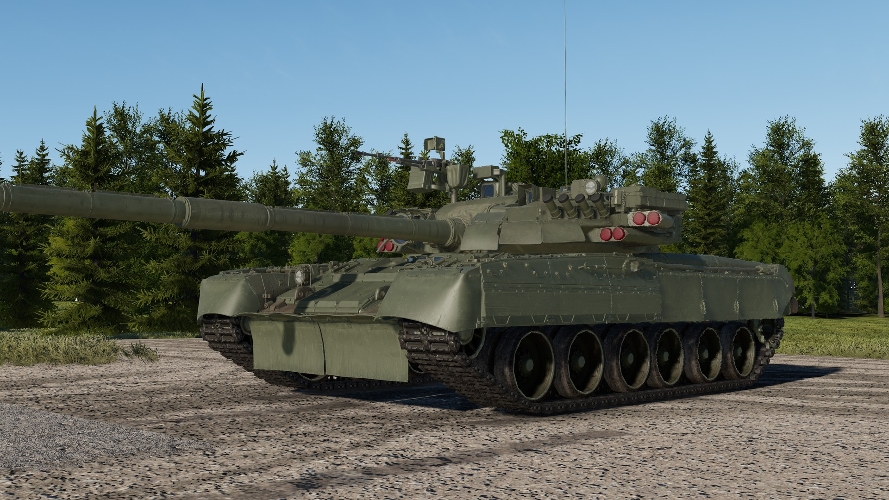
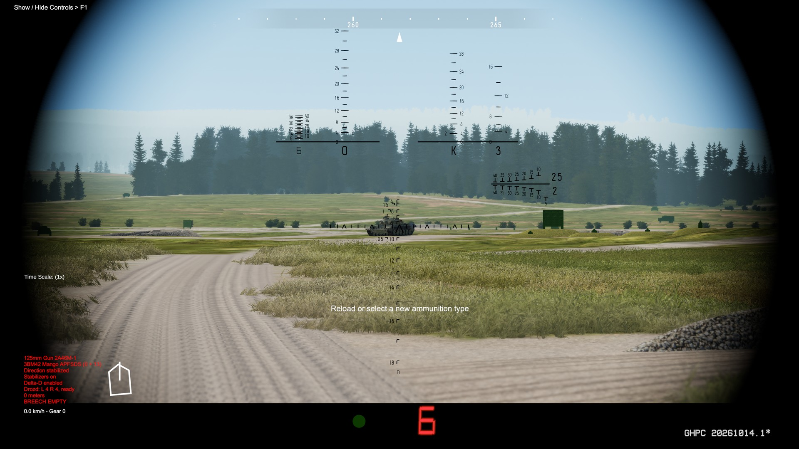
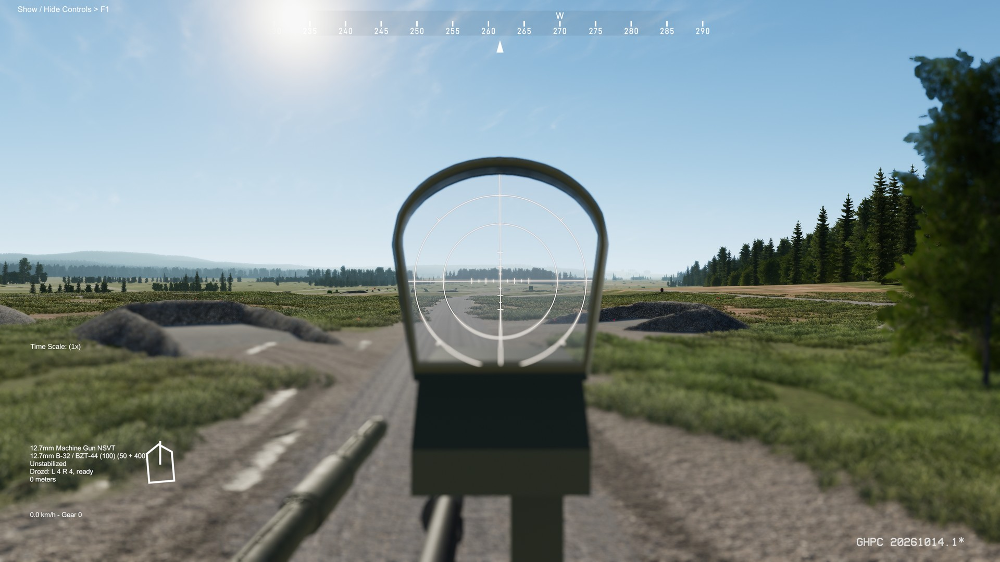
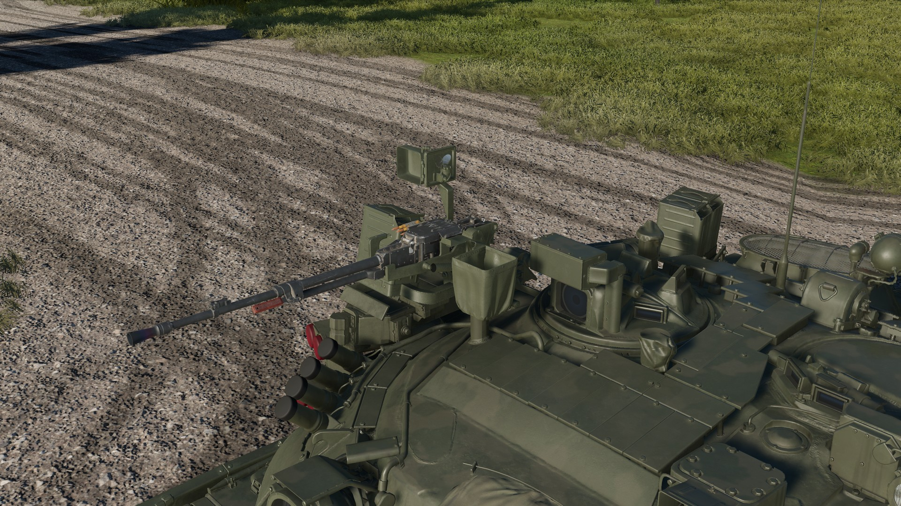
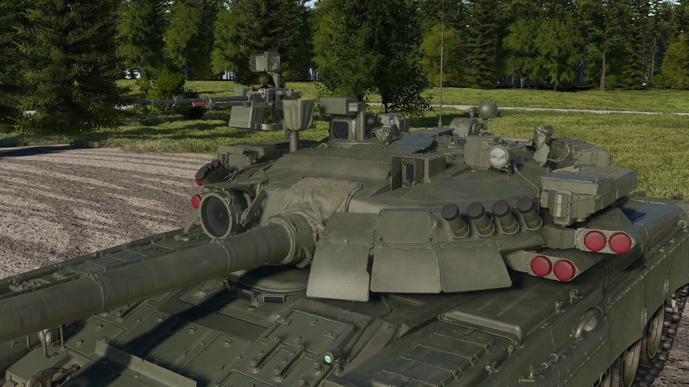
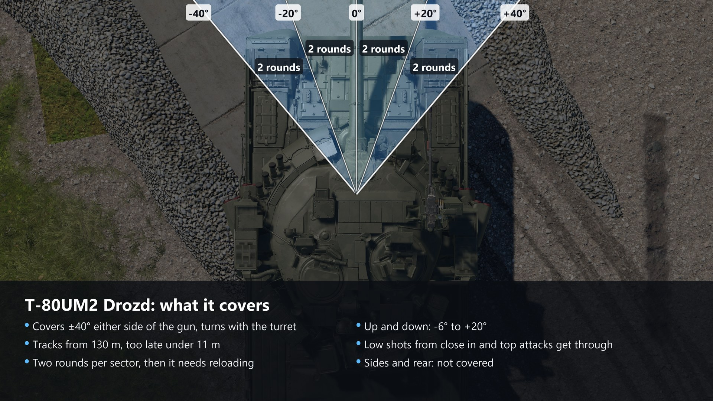

# T-80UM2 for Gunner, HEAT, PC!

A Russian **T-80UM2** for GHPC, as its own unit. A T-80U with the Drozd active protection system on the turret front,
Kontakt-5, the 1G46 sight with the Agava-2 thermal, Dubl for the commander, an NSVT on its pedestal, the Invar missile
and the GTD-1250 gas turbine.

I made this mod for myself first, but you're welcome to use it too. It's still being worked on, so a few things can
change between versions. It's a separate mod from my [T-90A](https://github.com/marsattackk/GHPC-T90A),
[T-90M](https://github.com/marsattackk/GHPC-T90M) and [Leclerc SXXI](https://github.com/marsattackk/GHPC-LeclercSXXI),
and they all work fine installed together.

<p align="center">
  
  
</p>

*On the right, Drozd setting off an RPG grenade before it reaches the tank.*

## Installing it

1. Get [MelonLoader](https://github.com/LavaGang/MelonLoader/releases) (0.7.3 or newer) into GHPC if you don't have it
   already. No other mod is needed.
2. Download `T80UM2_<version>.zip` from [Releases](../../releases/latest).
3. Copy the `Mods` folder from the zip into the game's `Bin` folder, the one with `GHPC.exe` in it (Steam: right-click
   GHPC > Manage > Browse local files, then open `Bin`). You should end up with:
   ```
   Mods\T80UM2.dll
   Mods\T80UM2\t80um2
   ```
4. Start the game. The T-80UM2 is in **Instant Action** (unit "T-80UM2"), in the **Soviet campaign** roster, and in the
   "Showcase of most playable vehicles" mission. Only one was ever built, so in the campaign it's rare and only turns up
   after two missions. Both can be changed in the settings.

To remove it, delete `Mods\T80UM2.dll` and the `Mods\T80UM2` folder. That's safe mid-campaign too, because the campaign
save doesn't keep a list of units.

Once per game start the mod asks GitHub whether there's a newer release. If there is, you get one line with a link in
the MelonLoader console and that's it: nothing in game, nothing downloaded. `Check for updates` turns it off.

## Overview

In the late 1990s the Omsk plant took a T-80U and bolted a Drozd on the turret front: two twin launcher blocks and a
radar head each side, the same kind of kit a few T-55ADs had carried since the early 80s. It was shown in 1997 and 1999,
nobody bought it, and it spent the 2000s on trials at Kubinka. Years later it went to a line unit with the launchers off,
and it was destroyed in March 2022. This is the tank as it stood from 1997 to about 2012, blocks still on.

There was exactly one, and its spec sheet was never published. So under the Drozd this is a serial T-80U, and where even
that runs out it's my guess. Everything guessed is listed in [docs/details.md](docs/details.md#where-it-isnt-the-real-tank),
with the history and the sources.

In GHPC it's built on the game's T-80B, so the hull, the running gear, the carousel and the crew will all be familiar.
Above the turret ring it's a different tank. The cheeks are much stronger, there's Kontakt-5 on top, a thermal sight, the
Invar in place of the Kobra, longer rods and 150 hp more. The glacis under its ERA is no better than the T-80B's though.

Against my T-90A it's quicker, and the reverse is the big one: 11 km/h against the T-72's 4.2. Drozd and Shtora-1 do
different jobs. Drozd actually kills what's coming at your front, Shtora-1 spoils the other guy's aim, and neither does
anything against a dart. The T-90M is a 2020s tank and a different league, but the T-80UM2 still has the speed on it.

The gunnery is the T-80B's with better kit. If you've read the official
[T-80B gunnery guide](https://gunnerheatpc.com/news/articles/gunnery-guide-t-80b), most of what follows will sound
familiar.

## Target alerts

The crew are the T-80B's, Russian voices and all, and they call targets on the hull azimuth compass. "At 30" is dead
ahead of the hull, 15 is straight left and 45 straight right. The T-80B guide explains the system properly.

## 1A45 fire control with the 1G46 sight

<p align="center">
  
  
</p>

*Left: the 1G46 by day. Right: the Agava-2 thermal.*

The 1A45 "Irtysh" is the T-80B's 1A33 grown up, and the 1G46 replaces the 1G42. Over the T-80B you get a laser good from
400 to 5000 m, a 2.7-12x zoom, and a sight stabilised on its own, independent of the gun. It can look 8° either side of
the gun and from -15° to +20° up and down. You aim the sight and the turret catches up.

**Automatic and manual modes.** Same as the T-80B. Lasing (default E) puts the fire control in automatic, with
superelevation and lead on and the reticle centred. Setting the range by hand (default LCtrl + mouse wheel, or PgUp /
PgDn) drops it into manual, and the range scales at the top slide instead. Most of the time you want automatic. Manual is
for when the laser's gone.

**The drill.** Lase the target with the tip of the chevron. Then keep the tip on it for a full second, matching its
speed, because the computer works the lead out from that last second of traverse. Fire. If the reticle isn't glued to
the target while you track, the round goes wide. Lead is sideways only, as on the T-80B.

**Firing when laid.** After a lase the gun won't fire until it has actually climbed to the elevation the computer set,
which is what the real firing-permission circuit does. On a long shot you'll feel it as a short pause. With
`Fire only when the gun is laid` off it fires whenever you like, but a shot while the gun's still climbing falls short.

**Without the laser.** There's a stadia scale on the left for a target 2.5 m tall, from 800 m out. The coax PKT gets no
help from the computer: range the target, note the number, reset the range, and aim with the scale on the vertical line
under the chevron, which goes out to 1400 m.

**The strip under the picture.** Four range digits, and on their left the round in seven segments: Б for APFSDS, К for
HEAT, О for HE and У for the missile. The green lamp on the left means loaded and laid. The red one on the right means
the gunner hasn't got the gun: the commander has it in Dubl, or he's slewing it onto a target (default Spacebar).

## Night fighting

The Agava-2 thermal (default T) comes up on its monitor with the info blocks of the real one: mode and range top left,
four boxes top right and the ready lamp. It has two fields, 4° and 2° wide. Use the wide one to look and the narrow one
to shoot. The fire control works through it the same as through the day sight, so the drill doesn't change. The thin
cross in the middle is mine, because the photo of the real monitor doesn't show one clearly.

Like any thermal it sees through smoke and the laser doesn't. A range taken into a cloud is the cloud's.

The photos of this tank actually show the older TPN-4 Buran-PA image intensifier, so `Night sight` swaps that in, and
it changes at once without a restart. The Buran-PA works without the computer, like the T-80B's night sight, so go
into manual first and set the range by hand the way the T-80B guide says. Its range scale stops at 1500 m. Coming back from
the Buran-PA, the 1G46 keeps a range of 2000 m at most until you lase again.

## The commander's TKN-4S and the NSVT

<p align="center">
  
  
</p>

*Left: the TKN-4S by day. Right: the NSVT's K10-T.*

The commander has the free-look view like on the T-80B, plus the TKN-4S "Agat-S", a day and night sight in his cupola.
It's 7.8° wide by day and 11.5° at night. The cupola doesn't turn, so it looks where the turret looks.

**Dubl.** With the main gun or the coax selected, the TKN-4S lays and fires the gun from the commander's seat. It's the
real tank's backup for when the gunner's sight is knocked out. There's no laser and no computer here: judge the range
on the stadia, set it by hand, and the range line moves on the scale for the loaded round. His line and the gun's meet
at 1600 m, because the sight sits well off to the right of the gun.

**Target designation.** In the commander's own view, hold the game's Aim Override key and the turret slews onto what
he's looking at. Spot from the head view, hold the key, and let the gunner finish it off.



**The NSVT.** A 12.7 mm NSVT "Utyos" on its own pedestal by the commander's hatch, 450 rounds in boxes of 100.
Switch to the commander and select it like any other weapon. You aim through its K10-T, a 1x collimator with the
reticle floating in the glass and the world all round it, or straight from the head view. It's laid by hand and not stabilised, so stop the
tank or keep the bursts short. It goes all the way round and from -5° to +30°.

The real commander has to stand up out of his hatch to fire it. Here the hatch never opens and he fires it and changes
the boxes from under armour, so you're not exposed, which the real one very much was. The spent cases pile up on the
roof until you brake hard. AI crews leave it alone.

## Drozd

<p align="center">
  
  
</p>

*Left: two launcher blocks and a radar head each side, with their red covers. Right: what it covers.*

Drozd doesn't fool anyone. It shoots the thing down. It's on when the tank spawns and works by itself: the radar picks a
threat up at about 330 m and tracks it from 130, and a block fires a round that bursts a few metres in front of the tank
and throws a cone of fragments into its path. AI T-80UM2s get it too.

- It takes on anything between 70 and 700 m/s: ATGMs, RPG grenades, HEAT and HE shells. Missiles go down every time,
  grenades and shells most of the time. APFSDS is far too fast, as on the real one.
- It only covers the front, 40° either side of where the gun points. So, as with Shtora-1 on the T-90A, point the gun
  at whoever has the missile.
- It can't see below -6° or above +20°. A shot from low and close or a top attack gets through, and so does anything
  from the side or rear.
- There are 4 rounds a side, and each side needs 0.35 s before it can fire again. Two missiles at once on the same side
  can get one through. The other side has its own radar and doesn't care.
- It's no friend of infantry. The fragments go forward, and anyone standing in front of the tank when it fires is in
  trouble.

The weapon info at the bottom left shows a line like `Drozd: L 4 R 4, ready`. **Vehicle menu > Drozd > Reload** refills
the empty tubes at 60 s a round with the tank stopped. **Toggle APS** turns it off, but the real one took 5 minutes to
warm up again and so does this one, so don't switch it off mid-fight. A block or radar head that gets hit is gone
for the mission and takes its sectors with it.

The eight smoke tubes are the T-80B's, and they fire the game's ordinary salvo. How Drozd works inside is in
[docs/screens.md](docs/screens.md).

## Armour protection


From the front, above the ring, it's strong. The T-80U's cast cheeks are far better than the T-80B's, and on paper,
with Kontakt-5 on top, they're well past what a 3BM42 or a 3BK18M can do. So is the glacis, but only while its ERA lasts.

Straight from the front, in mm of steel, without ERA:

| | Turret cheeks (vs APFSDS / vs HEAT) | Upper glacis (vs APFSDS / vs HEAT) |
|---|---|---|
| **T-80UM2** | **744 / 984** | **485 / 653** |
| T-90A | 690 / 819 | 549 / 748 |
| T-80B (vanilla) | 595 / 669 | 485 / 602 |

Kontakt-5 adds about 140 vs APFSDS and 550 vs HEAT on top. The cheeks get the same step up from the published figures
that GHPC gives its own T-80B and T-72M1. `Armour preset` set to `"source-only"` gives you the lower published ones.

The weak spots are the T-80's own. The lower front plate under the glacis lets everything through. So does the glacis
once its Kontakt-5 has gone off, because underneath it's a T-80B's. The mantlet round the gun is plain cast steel, and
the Drozd blocks on the turret corners are lightly armoured boxes, so a hit there costs you that side's cover.

From the side the hull stops nothing a tank fires, and the carousel's charges stand upright under the turret like on any
T-80. The roof is 30 mm and the engine deck 20. Keep it hull-down and nose on, and it's a hard tank to kill.

Where the numbers come from, my test firing and every weak spot: [docs/armour.md](docs/armour.md).

## Ammunition


*Pressing O: the carousel under the turret floor and the hand-stowed rounds round it.*

40 rounds: 19 APFSDS, 9 HEAT, 8 HE-Frag and 4 Invar. 28 sit in the carousel and the rest in the T-80B's tank rack and
across the turret rear. The real tank carries 45, but the last five places were right round the gunner's head, so I
left them out. The autoloader takes 7.1 s a round, and the coax PKT has 1250 rounds.

| Round | Penetration |
|---|---|
| 3BM42 "Mango" (default) | ~580 mm at the muzzle, ~460 mm at 2 km |
| 3BM59 "Svinets-1" | ~600 mm at the muzzle |
| 3BM60 "Svinets-2" | ~690 mm at the muzzle, ~600 mm at 2 km |
| 9M119M "Invar" | 700 mm, tandem |
| 3BK18M HEAT, 3OF26 HE-Frag | the game's own rounds |

You pick the dart in the game's normal ammo menu. 3BM42 is the default because it's what a serial T-80U carried, and
it's plenty for an M60 or a Leopard 1. For the front of an Abrams, take 3BM60 if you've got it and go for the lower
plate at long range. The serial T-80U's loader can't take long rods like 3BM59 and 3BM60, so those two assume this
tank's was reworked like later T-80s'. Treat them as a what-if.

HEAT for light vehicles and anything with an M60's armour or less, HE for infantry and soft stuff, same as on the T-80B.

**The Invar.** The 9M119M rides a laser beam from the 1G46, so it goes where the chevron is. Keep the tip on the target
until it hits. It arms at 100 m and takes about 17.6 s to reach 5000 m, and its tandem warhead sets ERA off before the
main charge. That's further than any tank round in the game, but it's also a long time to sit still, so pick your
moment.

Keep the nose and the gun towards trouble, let Drozd deal with the missiles, and when it goes wrong, use the reverse.
No T-72 can get out of a fight like this one.

## Settings

After the first start, `UserData\MelonPreferences.cfg` in the game folder has a `[T-80UM2]` section. Close the game
before editing it.

| Setting | Values | Default |
|---|---|---|
| `Enabled` | true / false | true |
| `Add to campaign roster` | true / false | true |
| `Campaign prevalence` | how common it is (1 = as common as a typical tank) | 0.15 |
| `Campaign unlock after missions` | number | 2 |
| `Weathered paint` | true / false (clean factory paint) | true |
| `APFSDS` | `"3BM42"` / `"3BM59"` / `"3BM60"`, where the game doesn't pick one itself | 3BM42 |
| `Force APFSDS` | true: the campaign gives every T-80UM2 the `APFSDS` round instead of drawing one from its ammo supply | false |
| `Drozd` | false: the blocks are there but do nothing | true |
| `Fire only when the gun is laid` | true: after a lase the gun waits until it's at the elevation the computer set. false: fires any time, but a shot while it's still climbing falls short | true |
| `ERA destruction effects` | true: a Kontakt-5 box that's gone off blows open and the plate round it is sooted | true |
| `NSVT spent cases` | false: no cases, the belt still feeds | true |
| `Night sight` | `"Agava-2"` / `"Buran-PA"`, changes at once | Agava-2 |
| `Armour preset` | `"game-scale"` / `"source-only"` (the lower published figures) | game-scale |
| `Check for updates` | true / false | true |

Leave the `ConfigVersion` line at the end alone. It's how the mod tells which settings are still on an old default.
Most settings apply to T-80UM2s spawned after the change. The three campaign settings take effect at the next mission
load, no restart needed. A number saved with a decimal comma (`"0,3"`) is read fine too.

## Bugs and suggestions

I'm open to suggestions, fixes, better sources, pull requests, whatever you've got. If you know something about the real
T-80UM2 (or the T-80U) that the mod gets wrong, tell me. With this one there's a lot of room for that.

Found a bug? Open an [issue](../../issues) and attach `MelonLoader\Latest.log` from the game folder. The mod writes a
warning there whenever something didn't load right or a game update has broken one of its hooks.

I only make and test it on the current Steam version of GHPC. A cracked copy or an old build might not load it at all
and I can't help with those, so make sure you're up to date before opening an issue.

## Maintaining it

The whole source is here so anyone can keep the mod working after a GHPC update without waiting for me. Pull requests
are welcome, and under the GPL a fork is fine too.

`T80UM2\` is the tank itself and `Common\` is the machinery it's built with, shared with my other ports. `Resources\`
holds the data built into the DLL. The asset bundle (`Mods\T80UM2\t80um2`: model, textures, armour) isn't built from this
repo, and neither is the Unity project behind it, so take it from a release.

To build it you need the .NET SDK 6 or newer and GHPC with MelonLoader, because the build references the game's DLLs:

```
dotnet build -c Release -p:GameDir="<GHPC folder>\Bin"
```

The DLL lands in `bin\Release\T80UM2.dll`.

When a game update breaks something, start with this:

```
powershell -ExecutionPolicy Bypass -File tools\check-game.ps1 -GameDir "<GHPC folder>\Bin"
```

It looks up every hook the mod has in the new game's DLLs without starting the game and lists what's gone. A broken
hook only takes its own feature down, and `MelonLoader\Latest.log` names it. [docs/game-updates.md](docs/game-updates.md)
goes through the rest of the repair and what to test after it.

`dotnet test tests` runs everything that doesn't need the game (the reticles, the armour data, the settings).
`tools\check-settings.ps1` makes sure the settings table above still matches the code, so a new setting needs a row there.

For the rest, [MAINTAINING.md](MAINTAINING.md) covers the layout, what happens when a T-80UM2 spawns, the settings and
releasing, and [docs/bundle.md](docs/bundle.md) says what the code expects to find in the bundle.

This README follows `main`, which can be ahead of the latest release.

## Where the model comes from, and the licence

The 3D model and textures are War Thunder's T-80UM2, taken from War Thunder's game files. They belong to Gaijin
Entertainment and they're not covered by this repository's licence. The same goes for the armour shapes, cut from War
Thunder's damage model. Everything else (the armour values, Drozd, the sights and their reticles, the fire control, the
ammo, the interior) was built for GHPC from Russian sources and, where those ran out, my own best guesses.

The source code is under the [GNU General Public License v3.0](LICENSE).
