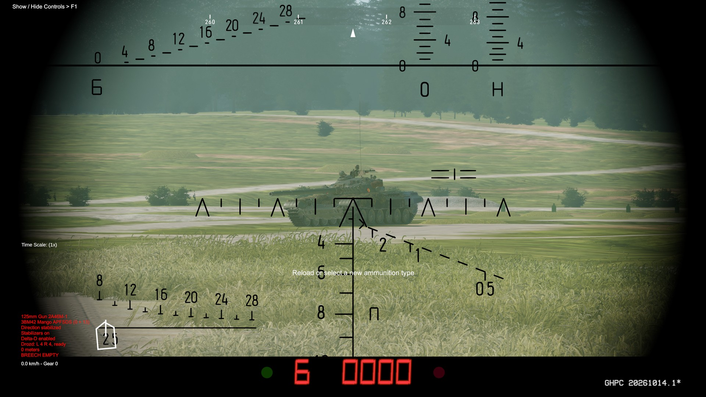
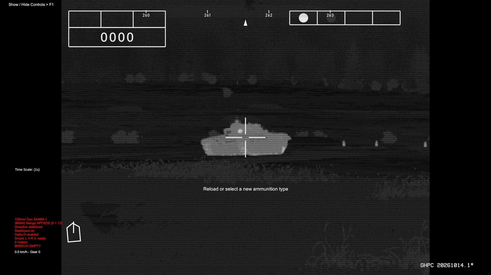
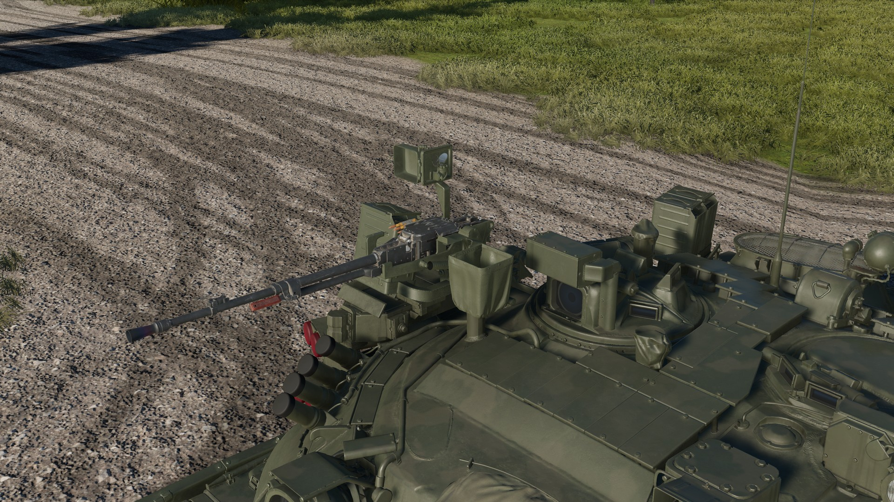
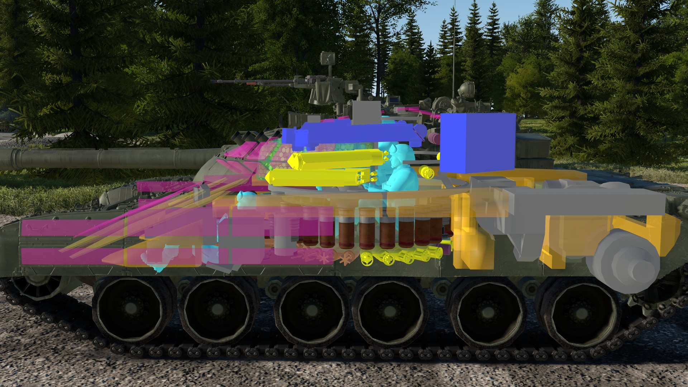

# The T-80UM2 in detail

The bits that didn't fit in the [README](../README.md): what I kept of the T-80B it's built on, the sights, the НСВТ and the ammo up close, the numbers, and where the mod isn't quite the real tank. The armour has its own page, [armour.md](armour.md).

## From the T-80B to the T-80UM2

The looks come from War Thunder and so do the shapes of the armour plates, because its damage model is a good map of where every plate and every reactive box sits. What those plates are worth, and everything that decides what happens when a round hits, was built for GHPC with GHPC's own rules.

The real tank is a T-80U with the «Дрозд» (Drozd) on the turret front, and the T-80U is the T-80B grown up. So underneath it's the game's own T-80B: the rig the turret and gun hang on, the running gear and its physics, the hull internals, the carousel autoloader, the crew and their voices, the army, the turbine's sound and the damage model's layout. What changed on top:

| | T-80B (as GHPC has it) | T-80UM2 (this mod) |
|---|---|---|
| Turret cheeks, no ERA, vs APFSDS / HEAT | 595 / 669 | 744 / 984 |
| Upper glacis, no ERA, vs APFSDS / HEAT | 485 / 602 | 485 / 653 |
| ERA | none | «Контакт-5» (Kontakt-5), about +140 vs APFSDS / +550 vs HEAT |
| Active protection | none | «Дрозд»: 2 radar heads, 4 launcher blocks, 8 rounds |
| Gun | 2А46-2, -5° / +15° | 2А46М-1, -5° / +14°, -4° over the engine deck |
| Gunner's sight | 1Г42 with 1А33 | 1Г46 with 1А45 «Иртыш», laser 400 to 5000 m |
| Night sight | ТПН-3-49 image intensifier | «Агава-2» thermal, or the ТПН-4 «Буран-ПА» |
| Commander | free-look head view | the same view, plus the ТКН-4С with «Дубль» and target designation (ЦУ) |
| Commander's MG | NSV on the cupola, for looks | НСВТ «Утёс» on its pedestal, hand-laid, with the К10-Т |
| Main gun ammo | 38 rounds, 3BM15 and co. | 40 rounds, 3BM42, 3BM59 or 3BM60, 3BK29M, 3BK31 or 3BK18M, and the 9M119M «Инвар» (Invar) missile |
| Coax | ПКТ, 2000 rounds | ПКТ, 1250 rounds |
| Engine | ГТД-1000ТФ, 1100 hp | ГТД-1250, 1250 hp |
| Mass | 46.5 t | 47 t |

The fire control's machinery, the laser and the stabiliser are the T-80B's, with the T-80U's sights and numbers on top. The commander's НСВТ station is built from the game's T-64B machine-gun station, the same donor my T-90s' Kord uses. The ammo models are reshaped from the game's own rounds. The 902Б «Туча» smoke tubes are the T-80B's eight. The war paint and the weathering are made for this tank's own shape.

What the mod keeps of the T-80B is also what it can't fix. The hatch the commander would climb out of is the T-80B's and it never opens (more under the НСВТ). The interior is the T-80B's layout with a few T-80U parts added where photos show them. The ones that are inferred are listed further down.

## A bit of history

Only one was ever built, and almost nothing was published about it. In the late 1990s the Omsk plant (the transport machinery plant, «Омсктрансмаш») took a T-80U and fitted a «Дрозд» of the 1030М type on the turret front. That's four twin-tube blocks and a radar head on each side. The maker's own title for it at the ВТТВ-Омск-97 show was «Танк Т-80У с комплексом активной защиты "Дрозд"» (a T-80U with the «Дрозд» active protection system), with 8 launchers and a sector of up to 80°. It was shown there in 1997 and again in 1999. The name Т-80УМ2 comes later, from the press and the blogs. I found no «Объект» number for it. The «Объект 219АС-М» you see in a few places is the T-80УМ.

Nobody bought it. It spent the 2000s as a trial tank of the 38th research institute at Kubinka and the photos I found of it there date from 2008. Later it was a line tank in the 4th Guards Kantemirovskaya division. At «Запад-2021» it was seen with the launchers taken off, though the mounts and the smoke tubes were still there. It was destroyed near Trostyanets in March 2022.

It had a sister built at the same time, the Т-80УМ1 «Барс» with «Арена-Э» all round the turret, a different tank. The tank in this mod is the UM2 as it stood from 1997 to about 2012, in the olive of the Kubinka photos, with the «Дрозд» blocks still fitted.

## The sights

  
  

*The 1Г46 and the «Агава-2».*

**1Г46** with the **1А45 «Иртыш»**: stabilised on its own, 2.7 to 12x (20° down to 4.5°), and the zoom is continuous. The laser measures from 400 to 5000 m. The reticle is drawn from the manual's figure 9, with stadia for a 2.5 m tall target. The range, the round and the ready lamp are in the strip under the picture. The view sits where the T-80B's 1Г42 view does, on the gun, not in the head on the roof.

**«Агава-2»** (Т01-П02Т, the default): a thermal on a 4:3 monitor, white-hot, 288 lines. Two fields, 4 × 2.7° (x5.5) and 2 × 1.35° (x11), taken from the maker's table. It looks along the 1Г46's line, and the mirror goes -10° to +20°. The monitor has its info blocks as the photo shows them: the mode and the range top left, four boxes top right and the ready lamp. The thin cross in the middle is mine.

**ТПН-4 «Буран-ПА»** (the `Night sight` setting, and you can swap it in play): an image intensifier with a 5.25° field. The real one is rated to 1500 m, but the scales I drew and the mod's own range limit go to 2000 m. It fires with the computer off, so you set the range by hand on the scales. The reticle is my guess, laid out like the one on its Ukrainian successor, because I found no drawing of the real one.

**ТКН-4С** (commander): the T-90A's reticle, since it's the same sight. Day field 7.8°, night 11.5°, mirror -10° to +20°. With **«Дубль»** the commander lays and fires the main gun looking through it, with the computer off, the range set by hand on his stadia and no laser. The gun's line and his meet at 1600 m, because the sight sits 0.6 m right of the gun and over it. **Target designation** is the game's Aim Override key in his own view, and the turret slews onto what he's looking at. The cupola with the sight stays fixed on the turret, and nothing turns it.

## The НСВТ «Утёс»

The T-80U keeps the old open-type mount, a pedestal on the turret roof (the texts say «тумбовая установка») with a traverse handle, an elevation handwheel and a firing button. No spade grips. It's hand-laid, not stabilised, and aimed through the **К10-Т** collimator. I put one pedestal where War Thunder has it, 0.4 m right of and 0.5 m ahead of the cupola's centre. It goes through 360° at -5° / +30°. The mount itself does +75, and I stopped at +30 because that's about what a man can reach working the low handle.

- 450 rounds, four boxes of 100 and one of 50, the part box being the one loaded at spawn. The belt feeds round by round out of the box on the right of the pedestal head. It's 4 B-32 to 1 BZT-44, copied from the Kord's belt.
- The spent cases go out forward on the right and lie on the tank until it tilts or brakes hard enough to shake them off. `NSVT spent cases` turns them off.
- The К10-Т is drawn the way it looks through the real one: the reticle only inside the sight's plate, the world all round at 1x with both eyes open, and the light filter darkening it by day. The eye sits 155 mm behind the plate, which is the sourced figure for the big ring.
- AI crews don't use it.

On the real tank the commander climbs fully out of his hatch to fire it and to change the boxes, and the spare boxes are outside on the turret. Here the commander's hatch never opens, so you fire it and change the box from under armour. The T-80B he's built on has no head-out position for him.

## The ammo

*Pressing O: the carousel under the turret floor and the hand-stowed rounds round it.*

- **28 in the carousel** and **12 stowed by hand**: 40 rounds in all. The real tank carries 45. The five I dropped sat round the gunner's head in the T-80B's interior, and a hit would have cooked him on the spot.
- The 12 sit in the T-80B's tank rack and its documented places, and across the turret rear.
- The rounds are 19 APFSDS, 9 HEAT, 8 HE-Frag and 4 Invar. That mix is mine. No source gives a standard load.
- **3BM42** is the default, because that's what a serial T-80U carried. **3BM59** and **3BM60** are long rods that the serial loader can't take. Later T-80s had it reworked for them and I assumed this tank's was too.
- The 3BM60 is the one I use in my T-90s. The 3BM59 has no figure of its own: I took the 3BM60's and scaled it by the ratio of the two rounds in two lists (0.86), which gives about 600 mm at the muzzle.
- The Invar is the 9M119M, 700 mm, 100 to 5000 m, tandem warhead, guided along the gunner's sight line.
- Each round has its own stencils and shape, made from the game's own models so they sit next to the vanilla shells.

## The paint

Plain olive as in the Kubinka photos, with the olive canvas cover on the mantlet. Weathered by default and made for the T-80UM2's own shape: dust and mud heavier toward the ground, grime in the crevices, streaks down the sides, rust and chipped edges. `Weathered paint` set to false gives the clean factory finish. The 1997 sand and green isn't in.

## Numbers

| | |
|---|---|
| Engine | ГТД-1250 gas turbine, 1250 hp, the T-80B's 4+1 gearbox with a final drive of 5.216 (mine, solved for 70 km/h at the T-80B's engine scale, not the T-80U's 5.45) |
| Mass | 47 t |
| Speed | about 70 km/h forward (68 to 70 in game), 11 km/h reverse |
| Turret traverse / gun elevation | 25°/s / 25°/s |
| Gun | 2А46М-1, -5° / +14° over the front, -4° over the engine deck |
| Autoloader | 7.1 s for every round, 28 in the carousel |
| Main gun ammo | 40 rounds: 3BM42, 3BM59 or 3BM60, 3BK29M, 3BK31 or 3BK18M HEAT, 3OF26 HE-Frag, 9M119M Invar |
| Coax ПКТ | 1250 rounds (5 belts of 250) |
| НСВТ | 450 rounds, 740 rounds a minute, -5° / +30°, by hand |
| Smoke | 8 × 902Б «Туча», 3Д17 aerosol grenades, no spares |
| Drozd | 8 rounds (4 a side), ±40°, -6° / +20°, targets at 70 to 700 m/s |
| Crew | 3 |

| Round | Penetration |
|---|---|
| 3BM42 «Манго» (default) | about 580 mm at the muzzle, about 460 mm at 2 km |
| 3BM59 «Свинец-1» | about 600 mm at the muzzle |
| 3BM60 «Свинец-2» | about 690 mm at the muzzle, about 600 mm at 2 km |
| 9M119M «Инвар» | 700 mm, tandem warhead (sets off ERA first) |
| 3BK29M HEAT (default) | 700 mm guaranteed, 915 m/s, 18.4 kg. NII Stali's people wrote in 2019 that it was only ever meant for add-on ERA, so Kontakt-5 counts in full against it. Behind add-on ERA it keeps 650 mm, which is my reading of an unlabelled figure in its data table |
| 3BK31 «Старт-2» HEAT | 800 mm, 660 behind built-in and 680 behind add-on ERA. Never adopted, so the campaign doesn't roll it. Its 905 m/s is a guess off its direct-fire range, which is 3BK18M's within 10 m. The two main charges fire as two jets, the first with a third of the penetration and the second with all of it beside it. Both figures are guesses, nobody publishes the split |
| 3BK18M HEAT, 3OF26 HE-Frag | the game's own rounds |

| «Дрозд» | |
|---|---|
| Search / tracking | the radar picks a threat up from 330 m and tracks it from 130 m |
| Burst | the round bursts 6 to 8 m in front of the tank, a cone of about 230 fragments |
| Time before it fires again | 0.35 s per side, the other side 35 ms later |
| Chance to kill | missiles 1.0, HEAT and HE shells 0.78, grenades 0.7 |
| Warm-up after you switch it off and on | 5 minutes |
| Reload from the vehicle menu | 60 s a round, the tank stopped |

## Where it isn't the real tank

A lot of this is my best guess, because the tank was one of a kind and its figures were never published. The rest are choices I made on purpose. If you've got a real source on any of it I'd like to see it.

**What the tank is**

- The tank is a T-80U with the «Дрозд» on, as far as the photos and the maker's entry go. Everything no source says about the UM2 itself is the serial T-80U's: the armour, the gun, the sights, the НСВТ and its 450 rounds, the ПКТ, the smoke tubes, the 70 km/h. I found no «Объект» number for it.
- The «Дрозд-2» label from the press and the blogs describes something else. The ЦКИБ СОО brochure has 5-round all-round modules with 95 mm rounds. The photos and the maker's 1997 entry show 8 forward-firing tubes, so I built that one, the 1030М type. I call the tank the T-80UM2 because that's the name players know.
- I show the tank as it was from 1997 to about 2012, with the launchers fitted. The 2021 state, with the launchers removed, isn't in. The engine sub-type is a guess too: no source names it, and the ГТД-1250 is what T-80Us had from 1990.
- The mass is the T-80U's 46 t plus 1 t for the «Дрозд», which is my sum. The fuel is the T-80B's tankage, and my estimate is that it's within about 2 % of the T-80U's.

**«Дрозд»**

- The 0.35 s between engagements is sourced. I took it as per side, because one Russian text says the other side can go 35 ms after, and the other text says 0.35 s for the complex. The 35 ms is sourced too. Each side having its own radar is how I reconciled the two.
- The 0.02 s from detection to launch is worked back from one trial: a grenade fired at from 11 m was destroyed. No source gives a reaction time. The only other figures I found were 0.06 s (War Thunder) and about 0.35 s, which I think is the re-engagement time misread.
- The protective round flies at 190 m/s (ru.wikipedia and others). One journal says 120 m/s, and with that the 11 m trial couldn't have worked. It's a mortar-fired 107 mm shell with no motor trail, so the launch has no flame.
- The smallest threat it reacts to is 10 cm² of radar cross-section, which I read as a disc about 36 mm across. The text says «10 см», and read as 10 cm in diameter it would ignore the RPG-7.
- The kill chances are per class from the state trials: 1.0 against missiles and 0.78 overall. The 0.7 for grenades is the specification's. How often a kill only breaks the threat up and doesn't set off its warhead (1 in 4) is mine, because the sources list destruction, detonation and deflection and give no split.
- The fragment cone is ±30° and about 230 fragments (ru.wikipedia and an area density of 120 per m² at 1.5 m), and I took the field to reach 5 m ahead of the burst. That reach is mine. The fragments' own penetration, drag and area are borrowed from the T-90M's 3 g «Тельник» element, about 6 mm at 1200 m/s, which makes about 10 mm at the 1600 m/s these fly at. The 1.5 m the density holds out to is my reading of the source. A warhead set off by the fragments throws a quarter of GHPC's own fragment count, also my number.
- The computer picks whichever tube's burst the threat will fly through. Which block takes which sector I read off the model's tube axes: the lower blocks straight ahead and the upper ones 20° out. That's inferred. The upper blocks' tubes point 19° out in the model where the source says 20°, and I kept the model's. The blocks' 25 mm housings are mine too. The one sourced fact is that they stop 12.7 mm.
- The 5 minutes' warm-up is sourced (btvt's «готов через 5 мин»). That it's armed at spawn and only needs them after you switch it off and on in play is my reading.
- The reload is my own option, 60 s a round from the vehicle menu with the tank stopped. The maker gives 15 minutes for all 8, and nothing says what a crew did in the field. There's no limit on spare rounds, because nothing says how many the tank carried.
- It won't fire while a crew hatch is open, as the real one's interlock. In this mod the commander's hatch never opens, so that never happens.
- The launch and burst are the game's own sounds and effects. I haven't done a pass against footage, so how the burst looks is a stand-in.

**Sights**

- The «Агава-2» is my guess. The photos of this tank show the older «Буран-ПА» box, and the «Агава-2» went on the T-80УМ (1992), the T-80УК and a few T-90s. The «Буран-ПА» is one setting away.
- The thin centre cross on the «Агава-2» monitor is mine. No source says whether the computer's aim shows as a moved mark or only moves the picture. The monitor is 288 lines on a 4:3 screen stretched over a 16:9 one.
- The «Буран-ПА» reticle is my layout from the successor sight. Its image is the game's image intensifier look, and the 5.25° and 1500 m are from Suvorov's table.
- The 1Г46 and the «Агава-2» views sit where the T-80B's sights are, on the gun, not in their heads on the roof. The 1Г46's fire-gate angle is GHPC's 1А33 value and its range steps are the T-90A's, both inferred. The «Агава-2»'s ±7.5° of azimuth is inferred as well. The 1Г46's stadia are set for 2.5 m, which three of four pictures show and one manual says 2.7.
- The ТКН-4С's reticle is the T-90A's. Its day field is 7.8°, which I measured off a photo for that tank. Suvorov's table says 7°. The night field and the eye point are the T-90A's, so inferred, and so are its day and night magnifications (7.5x and 5.1x). The 0.6 m the sight sits right of the gun is read off the model's sight box. The 1600 m where «Дубль» converges is the family's distant-point rule from the T-72A's manual, inferred for this sight because the ПНК-4С manual gives no figure.

**The НСВТ**

- The commander fires it with the hatch shut and no figure of him outside. The real one stands out of the hatch, but the T-80B has no head-out position for him, so here he's never exposed. A hit on the НСВТ's spare boxes has no effect yet.
- One pedestal at War Thunder's place. The sources disagree: some T-80B texts put the mount on the cupola, and one T-80U text has three pintle sockets round it. +30° is my limit. The mount does +75.
- 740 rounds a minute is the middle of the «680-800» the T-64A's manual gives for its mount. The hand traverse of 120°/s and elevation of 60°/s, the 15 s to change a box, the place, speed and spread of the ejected cases and the К10-Т's 45° view are my own numbers. So are the 14 spare rounds of belt drawn between the box and the gun, and the pedestal's place, 0.4 m right of and 0.5 m ahead of the cupola's centre. The К10-Т's ring radii on screen I read off a schematic.
- The belt's mix is the Kord's 4 B-32 to 1 BZT-44. I didn't find the НСВТ's own. The round drawn in the belt is the Kord belt's
  round from my T-90A (the same 12.7 × 108 cartridge), so its files carry the Kord's name. The gun itself has no hit zone of its own and its magazines aren't modules.

**Armour** (the shapes are War Thunder's and the values are mine)

- The default `Armour preset` is game-scale: cheeks 744 / 984 and glacis 485 / 653. The published figures for the T-80U's cast turret are lower: 620 / 900 for the cheeks (a table of the T-80УД, the same turret, which I read as without ERA) and 430 / 566 for the glacis. GHPC rates its own T-80B and T-72M1 about 10 to 20 % over their real figures, so the cheeks get the step my T-90A got, and the glacis matches the vanilla T-80B's 485 because a lower one would put it under the tank it's built on. `source-only` gives the published ones.
- The glacis is the T-80BV's stack with the 30 mm «Отражение» plate, calibrated to 430, and the HEAT value is from GHPC's own materials. The cheeks are calibrated to the target, not built layer by layer.
- Kontakt-5 is +140 vs APFSDS and +550 vs HEAT, spent after one hit, as on my T-90A. It's from the NII Stali's -20 % and -60 % and btvt's multipliers, applied to every element including the roof ones.
- The hull's rear plates are 80 mm (a T-80 text) and the hull sides over the engine 80 mm too. The lower side is 20 mm. One uncited infobox says 50. The hull roof is 30 mm (a text says «30 мм и менее») and the engine deck 20, which is my figure. The belly is 20 mm and also mine.
- The mantlet is War Thunder's shape in cast steel, at 0.95 of the cheeks' steel. No figure exists for the T-80U's. The rubber skirts are 0.8 mm, GHPC's convention.
- The anti-radiation lining is the T-64A's thicknesses, because they're the only ones I found. The model has none, so I put it in as new plates.
- The fender fuel tanks (five of them, two right and three left) and the APU bunker (rear of the left fender) are in at the T-80U's places from photos and texts, and marked inferred. War Thunder's model doesn't have them. The eight internal fuel tanks are in the hit report only and start no fire.
- The lower front plate, 80 mm at 60°, is from an uncited infobox. How many Kontakt-5 bricks sit in each block is my guess, and the roof's 22 or so is the shakiest count of all ([armour.md](armour.md)).

**Firepower and drive**

- The 2А46М-1 is the serial T-80U's gun. The -4° over the rear deck is from the T-64A's manual, and the rear sector's edges, ±150° to ±180° from the nose, are mine.
- The traverse and elevation of 25°/s are the T-80B's. One forum post says 16°/s for the 2Э42, and I didn't take it.
- The autoloader's 7.1 s is the T-64A manual's time for one step of the conveyor. GHPC has one time a round, so every round takes it.
- The 3BM42 and 3BM60 figures are the ones in my T-90A. The 3BM59's I scaled, as above, and its 4.5 kg, 1660 m/s and drag of 0.093 are inferred from the 3BM60. The 3BM42's drag is the game's 3BM32's. The Invar's 17.2 kg and its arming at 100 m are mine. Its 284 m/s is the speed that gets it to 5000 m in the maker's 17.6 s, and GHPC flies a missile at one speed. It blows itself up just past 5 km.
- The 40 rounds, the mix and the 12 hand-stowed places are my choice, as above. The type mix in the campaign is the same one. Its weights are a gameplay choice: the 3BM59 and 3BM60 at 0.5 against the 3BM42's 1, the tank itself at a prevalence of 0.15 from the 2nd mission.
- No source says which HEAT the UM2 carried, so it gets the T-90M's three: 3BK29M by default, 3BK31 and 3BK18M. The campaign rolls 3BK29M and 3BK18M at the same weight and never 3BK31, which only turns up if you pick it. The two Random settings are gameplay options, not a source's mix.
- The top speed of about 70 km/h comes from lowering GHPC's drag from 0.1 to 0.077. With 1250 hp and 47 t the tank levelled off at 63 km/h. The tuning gives 68 to 70. The final drive keeps the T-80B's 2300 rpm scale, so the rpm itself isn't the real 3150. For the same reason the final drive is my solved 5.216 and not the T-80U's 5.45, and the speed cap is 80 km/h. The reverse is the gearing's 11 km/h.
- The coax's 1250 rounds are the T-80U's. The T-80B has 2000.
- Eight smoke grenades and no spares, though the real tank carries 12. GHPC has no smoke restock. The cloud's 3 s build and 20 s life are mine, as on the T-90A. The launch angle is the 3Д17's 12°, because the model's tubes at about 41° would burst the grenade 40 m up.

**The commander and the crew**

- The commander isn't drawn when he's out, because he's never out. There is no figure of him. The version where he sat on the roof is switched off.
- The crew, the inside and the hit zones are the T-80B's. Where the model has no part I added one at the T-80U's place and marked it inferred. The periscopes are the T-80B's too.
- The T-80B's interior has the BV-1 trimmed into the wall by the commander's forearm. I haven't tidied that.
- The trimmed running gear pokes through the hull side in two places, about 60 cm² each, on both sides. I haven't seen it in a picture.

**Not seen in game yet**

- I've seen the Invar fly on the current build: out to 5081 m in 17.9 s, where it blew itself up. The 3BK29M HEAT and the 3OF26 load and fire, but I haven't watched either in flight.
- Two faults I've left for now. Entering the «Буран-ПА» clamps the lased range to 2000 m, and the 1Г46 keeps that range until you lase again. After a reload, `Fire only when the gun is laid` holds the shot until the gun is laid again.
- The «Дрозд» effects look pass against footage isn't done.

**Sources**

These are the ones the numbers above lean on. The armour's own are on [armour.md](armour.md).

- The tank: ВТТВ-Омск-97's exhibit page,
  [«Танк Т-80У с комплексом активной защиты "Дрозд"»](https://web.archive.org/web/20080205104154/http://www.rbs.ru/vttv/97/firms/c032/rd17.htm).
  Gur Khan's blog, [«Немного о Т-80УМ2»](https://gurkhan.blogspot.com/2015/03/802.html),
  [«Т-80УМ2 с КАЗ "Дрозд-2" замечан на учениях "Запад"»](https://gurkhan.blogspot.com/2021/09/802-2.html) and
  [«Уникальный танк Т-80УМ-2 с КАЗ "Дрозд-2" уничтожен в Украине»](http://gurkhan.blogspot.com/2022/03/80-2-2.html).
  «Российская газета» on «Запад-2021», [«Т-80 с комплексом активной защиты был замечен на учениях "Запад-2021"»](https://web.archive.org/web/20220624112929/https://rg.ru/2021/09/19/t-80-s-kompleksom-aktivnoj-zashchity-prinial-uchasti).
- Russian Wikipedia, [Т-80У](https://ru.wikipedia.org/wiki/Т-80У) and [Дрозд (активная защита)](https://ru.wikipedia.org/wiki/Дрозд_(активная_защита)).
- btvt.info, [«Основной боевой танк Т-80У «Объект 219АС»»](https://btvt.info/1inservice/t-80u.htm) and armor.photos,
  [«Основной танк Т-80У»](https://armor.photos/Tanks/Modern/T80/obt80u.php): the numbers of the base T-80U.
  The T-80's [«Описание конструкции танка Т-80»](http://www.plam.ru/transportavi/osnovnoj_boevoi_tank_t_80/p3.php) (the hull and its fuel tanks), and the ГТД-1250
  [catalogue of the gas turbine engines](https://kadvi.nt-rt.ru/images/manuals/Gazoturbinnie_dvigat.pdf).
- The «Дрозд»: btvt.narod.ru, [«КАЗ "Дрозд" (1030М)»](https://btvt.narod.ru/3/kaz_drozd.htm); dogswar.ru,
  [«Комплекс активной защиты «Дрозд» (СССР)»](http://www.dogswar.ru/oborydovanie/75-oborydovanie/9356-kompleks-aktivnoi-za.html);
  «Техника и вооружение» 2007-02, [«Комплексная защита бронетанковой техники. Украинский подход»](https://military.wikireading.ru/55939);
  Арсенал Отечества, [«Встречный удар. Комплексы активной защиты военной техники»](https://arsenal-otechestva.ru/article/248-counterstrike);
  sermonak.narod.ru's [«Средний танк Т-55»](https://sermonak.narod.ru/tank_1945_1990/t_55.html).
- The sights: odetievbrony.ru's manual excerpts,
  [«Комплекс управления огнем 1А45»](https://odetievbrony.ru/viewtopic.php?id=457),
  [«Прицел 1Г46»](https://odetievbrony.ru/viewtopic.php?id=447),
  [«Прицельно-наблюдательный комплекс ПНК-4С»](https://odetievbrony.ru/viewtopic.php?id=460),
  [«Тепловизионный комплекс ТО1-ПО2Т «Агава-2»»](https://odetievbrony.ru/viewtopic.php?id=759) and
  [«Зенитный прицел К10-Т»](https://odetievbrony.ru/viewtopic.php?id=769);
  Bulcomers' [K10-T page](https://bulcomersks.com/military-products/optical-equipment/collimating-sight/collimating-sight-k10-t/) (in English).
  S. Suvorov, «Т-90. Первый серийный российский танк» (book), for the ТКН-4С's field and the «Буран-ПА»'s.
- The НСВТ: t80leningrad.narod.ru, [«Танк Т-80 – острие карающего меча. Техническое описание»](https://t80leningrad.narod.ru/tank_t80_6.htm);
  odetievbrony.ru's [«Описание танка Т-80У»](https://odetievbrony.ru/viewtopic.php?id=342);
  andrei-bt's [«История с зенитной установкой танка…»](https://andrei-bt.livejournal.com/22137.html).
- [«Танк Т-72А. Техническое описание и инструкция по эксплуатации»](https://www.military-references.com/wp-content/uploads/books/tanks/ussr/t-72/%D0%A2%D0%B0%D0%BD%D0%BA_%D0%A2-72%D0%90_%D0%A2%D0%B5%D1%85%D0%BD%D0%B8%D1%87%D0%B5%D1%81%D0%BA%D0%BE%D0%B5_%D0%BE%D0%BF%D0%B8%D1%81%D0%B0%D0%BD%D0%B8%D0%B5_%D0%B8_%D0%B8%D0%BD%D1%81%D1%82%D1%80%D1%83%D0%BA%D1%86%D0%B8%D1%8F_%D0%BF%D0%BE_%D1%8D%D0%BA%D1%81%D0%BF%D0%BB%D1%83%D0%B0%D1%82%D0%B0%D1%86%D0%B8%D0%B8_%D0%9A%D0%BD%D0%B8%D0%B3%D0%B0_1_1986.pdf),
  book 1 (1986), for the conveyor's step and the 1600 m rule. The T-64A's manual says the same for its family.
- The rounds: [«Технологии в танкостроении. БПС»](https://glavcom.blogspot.com/2020/04/apfsdsbps3bm42mango3bm60svinec.html) on
  Главком's blog, btvt.info's [«Комплекс управляемого вооружения 9К119М «Рефлекс-М»»](https://btvt.info/3attackdefensemobility/tyr125.htm)
  and Rosoboronexport's [3УБК20 page](https://web.archive.org/web/20260831074331/http://roe.ru/production/land-forces/ammunition-sv/rounds/3ubk20/?theme=theme-green)
  on the Internet Archive.
- The armour: btvt.narod.ru, [«Основной боевой танк Т-80УД «Объект 478Б»»](http://btvt.narod.ru/4/t-80ud/t-80ud.htm) and
  [«Динамическая защита танков Контакт и Реликт»](https://btvt.narod.ru/4/kontakt5_.htm); btvt.info,
  [«Отечественные и зарубежные танки: мифы и реальность»](https://btvt.info/4ourarticles/dz_2014/dz_2014.htm) and
  [«Состояние и перспективы усиления защищенности современных танков»](https://btvt.info/4ourarticles/armor_72_80_84/armor_72_80_84.htm);
  Моделист-Конструктор's [«Основной танк Т-80»](https://modelist-konstruktor.com/bronekollekcziya/osnovnoj-tank-t-80);
  Army Guide's [«Динамическая защита «Контакт-5»»](http://www.army-guide.com/rus/article/article_2896.html).

## What it shares with my other tanks

The T-80UM2 came after my [T-90A](https://github.com/marsattackk/GHPC-T90A) and [T-90M](https://github.com/marsattackk/GHPC-T90M), and it leans on the same groundwork. The fire control and its fire gate, the reticle language (the 1Г46 and ТКН-4С drawn the same way, the thermal monitors built like the T-90A's ESSA), «Дубль» and target designation, the ammo menu and the rounds and the paint finish are all the same code, and so are the Kontakt-5 bricks. The НСВТ's station, with its belt feed and spent cases, is built like the T-90s' Kord station. A fix to one goes to the others.

What's only on this tank is the «Дрозд». Its radar, blocks and fragment cone are code only this tank has, and the T-90s' Shtora is a different kind of system. My [Leclerc SXXI](https://github.com/marsattackk/GHPC-LeclercSXXI) sits on the same T-80B rig, so it shares the rig and the machinery of the fire control with this one, and nothing else. It's still its own mod and none of them needs another.
