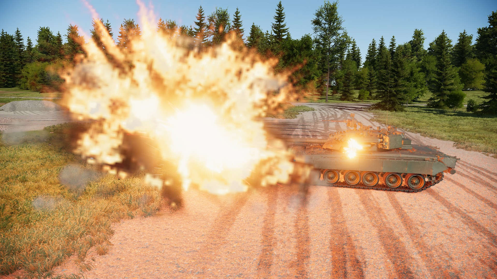
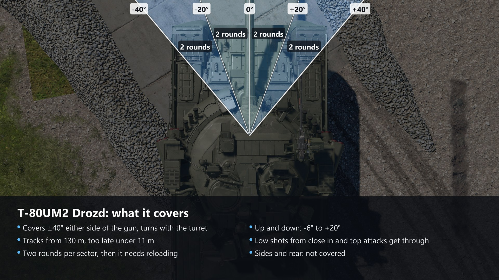

# «Дрозд» (Drozd)

The T-80UM2's countermeasures: the «Дрозд» hard-kill active protection, which shoots incoming missiles and grenades down in front of the tank, and the eight 902Б «Туча» smoke tubes with their 3Д17 aerosol grenades. What Drozd does in a fight is in the [README](../README.md#drozd). This is how each part works and what stops it.

The T-80UM2 has no laser warning, no jammer and no Shtora: the real tank doesn't either. So this page is not the T-90s' soft-kill page. It's the same job done the other way, with the radar, the launcher blocks and the smoke tubes the tank had.

  
  

*Left: Drozd bursting an RPG grenade a few metres in front of the tank. Right: the four 20° sectors, from above.*

## The radar heads

There are two radar heads (the «приёмопередающие модули»), one on each side of the turret, and they turn with it. Each watches its own side's 40°: the left head from the turret's axis out to 40° left, the right head the same to the right. So everything is relative to the turret, not the hull. Behind the turret is a third box, the computer (the ЭВС), which decides which tube fires and when.

The radar looks from 6° below the turret's level to 20° above it. It starts searching at 330 m and starts tracking at about 130 m, but only a round that is heading into the tank's outline. A round flying past, or going to hit the tank next to you, is ignored. These figures are from the manual's description of the 1030М complex (btvt's «КАЗ "Дрозд" (1030М)»), the *Техника и вооружение* 2007 article «Комплексная защита бронетанковой техники. Украинский подход» and *Арсенал Отечества*'s «Встречный удар». One Russian text gives 60 m for the start of tracking. I went with the three that say 130.

It only reacts to things between 70 and 700 m/s, so ATGMs and rocket grenades, and tank HEAT and HE shells that are slower than 700 m/s. APFSDS and anything slower than 70 m/s it doesn't touch. It also needs something of a size: the manual's «10 см» for the smallest target I read as 10 cm² of radar cross-section, which is a disc about 36 mm across. Every anti-tank grenade and ATGM passes that. The 36 mm is my own working out. If «10 см» meant a 10 cm diameter, it would ignore an RPG-7 warhead, and the sources say it doesn't.

It can't tell a friend's round from an enemy's, so it shoots at both. It doesn't shoot at your own.

## The blocks and the round

Each side has two twin armoured launcher blocks stacked one over the other, so four blocks and eight tubes in all, two rounds per block. Each block covers one 20° sector, which gives four sectors in front of the turret: left 40° to 20°, left 20° to 0°, right 0° to 20° and right 20° to 40° (manual: «Каждый бронеблок обслуживает сектор в 20 град.»; maker's 1997 Omsk show text for the eight launchers). Which block of a pair takes the inner sector and which the outer is my reading of the model's tubes: the upper blocks point 20° out and the lower ones straight ahead, so the upper ones take the outer sectors. The manual doesn't say.

The round is the 107 mm 3УОФ14, a high-explosive fragmentation shell fired from a short «мортира» tube, so it has no rocket trail. It goes out at about 190 m/s (ru.wikipedia's «Дрозд (активная защита)»; the 2007 article gives 120 m/s, which would have made the 11 m trial below impossible) and bursts 6 to 8 m from the tube mouths. The manual's figure is 6.7 m: its computer sets a remote time fuse for the moment the threat reaches the burst point. The flight takes about 35 ms.

The computer picks the tube whose burst the threat will actually pass through, not just the block for that bearing (the manual has the computer choose the «номер мортиры»). That matters for a shot at the upper glacis: the outer tubes point 20° out, and their burst would be about 3 m beside a missile flying straight at the hull.

The timings:

| What | Value | Source |
|---|---|---|
| Time between one threat and the next, per side | 0.35 s | manual: «Время готовности комплекса» 0.35 s; I read it as per side, since the manual and the developer's article only agree that way |
| The other side's radar | engages 35 ms after the first at the earliest | developer's article «Комплекс активной защиты «Дрозд» (СССР)»: threats «с разницей не менее 35 миллисекунд» |
| Detection to launch | 0.02 s | **mine**: that article says a grenade of 70-80 m/s fired from 11 m was destroyed, and working back from the 6.7 m burst point and the round's 35 ms flight leaves about 20 ms |
| Closest threat it can engage | 11 m | the same trial |
| Ready after being switched on | 5 min | manual: «готов ... через 5 мин» |
| Reload | 60 s a round, tank stopped | **mine**: the real reload is 15 min for all eight, done from outside; I made it a menu job so it's playable |

Two rounds a sector is all there is. A third threat into a sector whose block is empty goes through.

## The status line

There's no drawn panel for Drozd. The real tank has a control panel next to the commander showing which blocks still hold rounds. I couldn't find a picture of it, and I didn't want to invent a screen, so the mod gives you a line of text in the weapon info at bottom left instead:

`Drozd: L 4 R 4, ready`

That's the rounds left on the left and on the right, then the state: **ready**, **switched off**, **warming up, 240 s left**, **reloading, 55 s (3 to load)**, **reloading: stop the tank (3 to load)**, **hatch open** (with which one), **computer destroyed**. A radar head that's been shot off isn't in the line, but the side behind it stops firing.

The MelonLoader console gets a line for each intercept ("Drozd: intercepted ... (left inner block); 3 round(s) left on the left side"), for switching on and off, for each reload and for a launcher block that's destroyed.

## The screens

The eight 902Б «Туча» tubes, four a side, angled up above the Drozd blocks, fire 3Д17 aerosol grenades. That's the same grenade as on the T-90A, and it works the same way. The grenade goes out 50 to 80 m and bursts after about a second. The cloud builds up in about 3 s and hangs for about 20 s. It blocks lasers and eyes but not thermal sights, because the real one is made for visible light and near infrared. The range and the build time are from the T-90's texts on the 3Д17 («50-80 м за 2-4 с», and I use 3 s) and the fuse is «Через 1 с замедлитель сгорает». The 20 s is mine, the same figure as on the T-90A.

Launch angle is 12°, the 3Д17's own figure (btvt's «Комплекс оптико-электронного подавления «Штора-1»», written for the Shtora's tubes). For the T-80U's tubes it's my assumption, because the model's tubes point about 41° up and with a one-second fuse that would put the burst some 40 m in the air. Each grenade goes out along its own tube's direction, from the height of the model's tube mouths.

There's no laser warning on the T-80U, so there's nothing automatic: you fire them with the game's own smoke command, the same as on the vanilla T-80B, as a salvo. There are no spares. The real tank carries 12 grenades, 8 in the tubes and 4 spare (btvt's «Основной боевой танк Т-80У «Объект 219АС»»), but the game has no smoke restock, so the other four would do nothing.

## What it does to the threat

When the burst goes off, the fragments of the 107 mm round fly in a cone toward the threat. Sources give ±30° (ru.wikipedia) or a 30° full angle (*Арсенал Отечества*). I used ±30°. The fragments are about 3 g and go at about 1600 m/s, with a density of 120 per m² at 1.5 m from the burst (the Sermonak T-55 page «Средний танк Т-55»). The count I use, 230 fragments, is my own working out from that density over the cone. No source gives the penetration, so I borrowed the 3 g «Тельник» element's figure from the T-90M: 6 mm of steel at 1200 m/s, which is about 10 mm at the 1600 m/s these fly at. How far the fragments reach is a guess too: 1.5 m from the sources' density, but I count a missile still being hit 5 m ahead of the burst, because that's where about one fragment still meets it. That's what catches the shots at the upper glacis.

What the burst does to the threat is rolled by its kind:

| Threat | Chance it's stopped | Source |
|---|---|---|
| ATGM | every time | state trials, 1.0 against ATGMs |
| Tank HEAT and HE shell | 78 % | state trials, 0.78 overall |
| Rocket grenade | 70 % | the manual's specification, 0.7 |

In the 1981-82 state trials (more than 60 firings with live grenades and missiles) the system scored 0.78 overall and 1.0 against ATGMs (btvt's «КАЗ "Дрозд" (1030М)»). A threat that isn't stopped flies on to the armour as normal.

A threat that is stopped usually has its warhead set off in the air, metres from the hull. Sometimes it's broken up without going off. The sources list destruction, detonation and deflection but never give a split, so 1 in 4 stopped threats breaking up is my own number, and a warhead that goes off from my fragments throws a quarter of the fragments the game would give it on its own, also my number. A guided missile that's stopped stops being guided. The shooter's crew sees a miss, and an enemy shooter's AI turns toward where the round came from and tells its platoon.

The fragments go forward. Anyone in front of the tank when it fires is in trouble. Nobody behind is. The sources give no reliable danger distance for the 107 mm round (the maker gives 25 m for the 95 mm «Дрозд-2», btvt's «КАЗ "Дрозд" (1030М)»), so I left it to what the fragments do.

## When it won't fire

It won't fire when:

- it's switched off, or still warming up after being switched on
- a crew hatch is open (the real complex blocks the firing circuits with the hatches open, from the developer's article)
- it's reloading
- the computer on the turret rear is destroyed (the whole complex is dead with it)
- the block for that sector is empty or destroyed. A destroyed block loses its rounds, with no cook-off.
- the radar head on that side is destroyed. That side is blind, the other side carries on.
- the threat is inside 11 m, or only just seen (shorter than the 0.02 s reaction)
- the other threat on that side came less than 0.35 s ago

It doesn't see:

- anything from the sides or the rear, or more than 40° off where the turret points
- below -6° or above +20°, so a low shot from close in and a top attack both get through
- anything above 700 m/s (APFSDS, and the fast HEAT shells) or below 70 m/s
- a round that isn't heading for the tank

The blocks and the radar heads are armoured against 12.7 mm and little more (the developer's article). The 25 mm of armour on the housings in the model is my guess. A tank round that gets one takes it out.

## Using it

It's on when the tank spawns, for you and for AI crews. The AI never touches the menu, so theirs stays on and is never reloaded.

**Vehicle menu > Drozd** has:

- **Toggle APS**, which switches it off and on. The menu line shows the state, and when you switch it back on it takes 5 minutes to warm up, as the real one did.
- **Reload** (with the number of empty tubes), which refills them, 60 s a round, with the tank stopped (under 0.5 m/s). **Cancel Reload** appears while it's going. There are as many spares as you need, because nothing says how many the tank carried.

The red covers on the tube mouths go with each shot and come back on a reload.

The `Drozd` setting in the [README](../README.md#settings) takes the system off the tank: the blocks and heads stay but do nothing.

## How I checked it

I fired missiles, rocket grenades and APFSDS at the tank from the front in game, and then the shots it should let through: from the side, with a hatch open, at a block that's been shot off, a third round into an empty block and a grenade from inside 11 m. It stopped what it should and let those through. That included a Konkurs fired by another mod at the upper glacis, straight on and from 26° to the right.

I haven't tested it against an AI shooter's own missile. I also haven't judged the look and sound of a launch and a burst against real footage, because none turned up in my searches. The flash, the smoke and the double crack are my guess from how the round is built.
